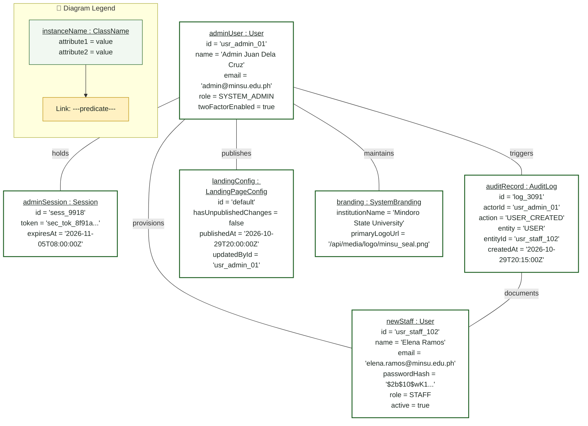

# System Admin — Object Diagram

> **Role:** `SYSTEM_ADMIN`  
> **Diagram Type:** Object Diagram  
> **Scenario:** Runtime Snapshot of Staff Account Creation, CMS Configuration, and Audit Logging  
> **Standard:** UML 2.5 Object Specification

---

## 1. Purpose

The Object Diagram shows a concrete runtime snapshot of objects, attribute values, and links created when an administrator provisions a staff account and updates landing page configurations.

---

## 2. Mermaid Object Diagram

---

## 3. Diagram Legend & Symbol Guide

| Visual Symbol | Syntax / Format | UML Role | MinSU Instance Context |
|---|---|---|---|
| `<u>instance : Class</u>` | Underlined Identifier | Concrete runtime object in memory | System Administrator, active session, new staff account |
| `attr = 'value'` | Key-Value Assignment | Concrete state of instance properties | `role = SYSTEM_ADMIN`, `twoFactorEnabled = true` |
| `---predicate---` | Undirected Semantic Link | Association relationship at runtime | Admin provisions account, publishes CMS config |
| 🟢 Green Container | `#1B5E20` / `#F1F8F1` | Verified Administrative Entity | Authenticated administrative user with valid session |

---

## 4. Runtime Object Attributes

- `adminUser`: Authenticated administrator account with active two-factor authentication.
- `adminSession`: Cryptographic 32-byte session token stored in PostgreSQL and httpOnly cookie.
- `newStaff`: Newly provisioned coordinator account hashed with bcrypt 10 salt rounds.
- `auditRecord`: Immutable security log capturing actor ID, timestamp, and entity diff.
- `landingConfig`: Split-screen CMS state synchronized to production with zero unpublished drafts.
- `branding`: Institutional crest URL serving sanitized SVGs with script-prevention headers.
