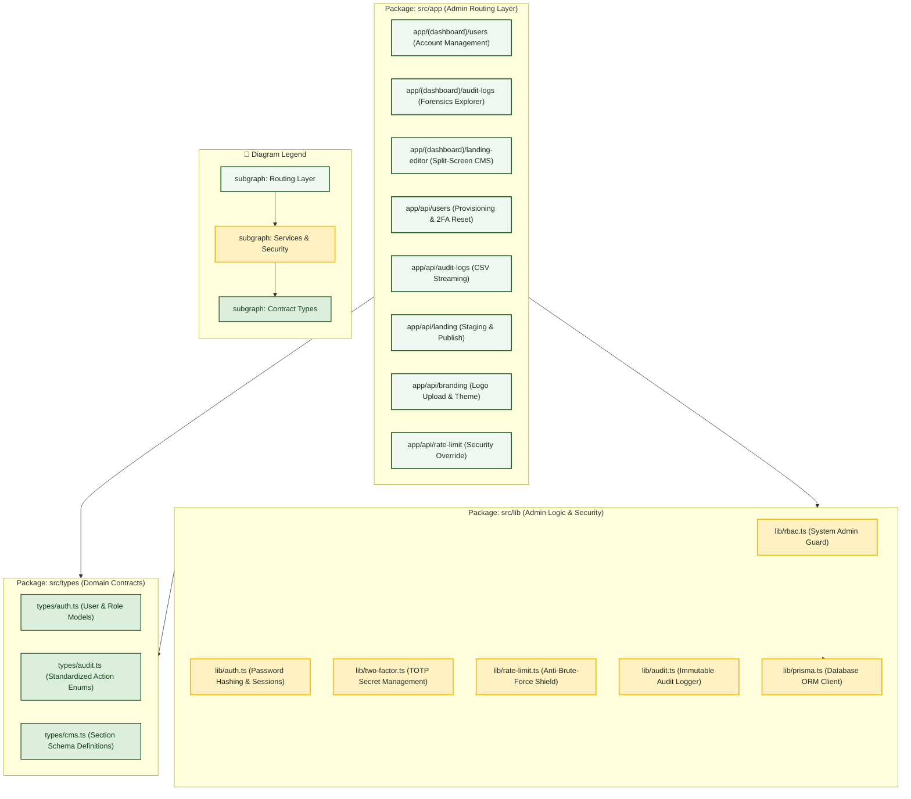

# System Admin — Package Diagram

> **Role:** `SYSTEM_ADMIN`  
> **Diagram Type:** Package Diagram  
> **Standard:** UML 2.5 Package Specification

---

## 1. Purpose

The Package Diagram shows the organization of codebase packages, route handlers, and modular dependencies that build the System Administrator subsystem.

---

## 2. Mermaid Package Diagram

---

## 3. Diagram Legend & Symbol Guide

| Visual Symbol | Syntax / Style | UML Package Concept | MinSU Implementation |
|---|---|---|---|
| `subgraph Pkg` | Folder Container | Architectural Namespace or Directory | `src/app`, `src/lib`, `src/types` |
| `[Module]` | Rectangle with border | Concrete file or sub-package | `users/page.tsx`, `two-factor.ts`, `rate-limit.ts` |
| `-->` | Directed Dependency | Import or invocation relationship | Admin routes depend on security guards and ORM clients |
| 🟢 Green Tone | `#F1F8F1` / `#1B5E20` | Administrative Presentation | Routes and UI views for administrator access |

---

## 4. Package Organization & Separation of Concerns

- **`src/app`**: Exposes administrative endpoints guarded by `SYSTEM_ADMIN` checks, including user management, audit forensics, CMS editing, and logo uploads.
- **`src/lib`**: Encapsulates core security mechanisms: bcrypt password hashing (10 salt rounds), TOTP two-factor management, IP-based rate limiting, and immutable audit dispatching.
- **`src/types`**: Declares TypeScript contracts for user profiles, standardized audit actions, and CMS section schemas.
