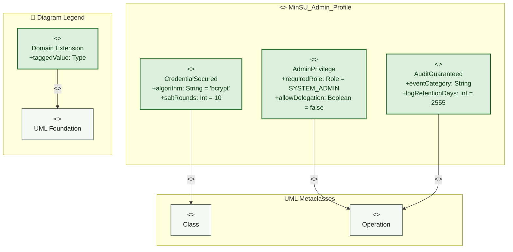

# System Admin — Profile Diagram

> **Role:** `SYSTEM_ADMIN`  
> **Diagram Type:** Profile Diagram  
> **Target Domain:** Security Governance & Audit Compliance

---

## 1. Purpose

The Profile Diagram defines domain-specific UML extensions for the administrative governance subsystem, including role privileges, audit guarantees, and credential hashing policies.

---

## 2. Mermaid Profile Diagram



---

## 3. Diagram Legend & Symbol Guide

| Visual Symbol | Syntax / Style | UML Profile Mechanism | MinSU Governance Application |
|---|---|---|---|
| `<<metaclass>>` Box | `fill:#F6F8F6, stroke:#55645B` | Core UML base meta-element | Standard UML `Class` or `Component` |
| `<<stereotype>>` Box | `fill:#DCEFDD, stroke:#1B5E20` | Domain-specific extension | `<<TDPAnnex>>`, `<<FinancialAnnex>>`, `<<AuditedEntity>>`, `<<ExecutiveReviewable>>` |
| `+taggedValue: Type` | Tagged Value Attribute | Metadata property attached to stereotype | `annexNumber`, `signatoryRole`, `slaHours = 48`, `requiresDisbursementCheck` |
| `-- "<<extension>>" -->` | Extension Relationship | Extends metaclass semantics | Connects custom TDP stereotype to standard UML metaclass |
| `-- "<<generalization>>" -->` | Specialization Hierarchy | Stereotype inheritance | `FinancialAnnex` inherits all properties of `TDPAnnex` |


---

## 4. PlantUML Profile Diagram

```plantuml
@startuml
skinparam packageBackgroundColor #FFFFFF
skinparam packageBorderColor #1B5E20

package "<<profile>> MinSU_Admin_Profile" {
  class "Class" <<metaclass>> as MetaClass
  class "Operation" <<metaclass>> as MetaOp

  class "AdminPrivilege" <<stereotype>> {
    + requiredRole : Role = SYSTEM_ADMIN
    + allowDelegation : Boolean = false
  }

  class "AuditGuaranteed" <<stereotype>> {
    + eventCategory : String
    + logRetentionDays : Integer = 2555
  }

  class "CredentialSecured" <<stereotype>> {
    + algorithm : String = "bcrypt"
    + saltRounds : Integer = 10
  }

  AdminPrivilege -up-> MetaOp : "<<extension>>"
  AuditGuaranteed -up-> MetaOp : "<<extension>>"
  CredentialSecured -up-> MetaClass : "<<extension>>"
}
@enduml
```

---

## 5. Stereotype Definitions

| Stereotype | Metaclass | Tagged Values | Description |
|---|---|---|---|
| `<<AdminPrivilege>>` | `Operation` | `requiredRole: Role`, `allowDelegation: Boolean` | Flags server actions that require administrator authorization. |
| `<<AuditGuaranteed>>` | `Operation` | `eventCategory: String`, `logRetentionDays: Int` | Guarantees that execution writes an immutable audit record. |
| `<<CredentialSecured>>` | `Class` | `algorithm: String`, `saltRounds: Int` | Enforces bcrypt salt rounds on entities containing passwords. |
