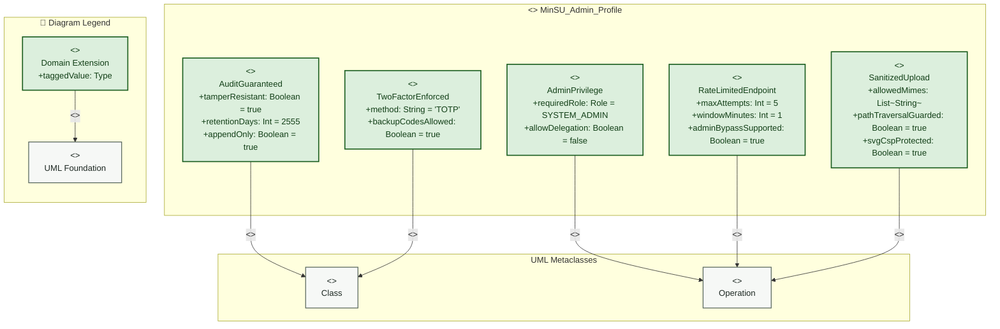

# System Admin — Profile Diagram

> **Role:** `SYSTEM_ADMIN`  
> **Diagram Type:** Profile Diagram  
> **Target Domain:** Security Governance, 2FA Policy, and Audit Compliance

---

## 1. Purpose

The Profile Diagram defines domain-specific UML stereotypes and constraints governing administrative authority, two-factor authentication, audit logging guarantees, and rate-limiting protections.

---

## 2. Mermaid Profile Diagram

---

## 3. Diagram Legend & Symbol Guide

| Visual Symbol | Syntax / Style | UML Profile Mechanism | MinSU Governance Application |
|---|---|---|---|
| `<<metaclass>>` Box | `fill:#F6F8F6, stroke:#55645B` | Core UML base meta-element | Standard UML `Class` or `Operation` |
| `<<stereotype>>` Box | `fill:#DCEFDD, stroke:#1B5E20` | Domain-specific extension | `<<AdminPrivilege>>`, `<<RateLimitedEndpoint>>`, `<<SanitizedUpload>>` |
| `+taggedValue: Type` | Tagged Value Attribute | Metadata property attached to stereotype | `maxAttempts = 5`, `appendOnly = true`, `svgCspProtected = true` |
| `-- "<<extension>>" -->` | Extension Relationship | Extends metaclass semantics | Connects custom admin stereotype to standard UML metaclass |

---

## 4. Stereotype Tagged Values & Rules

- **`<<AdminPrivilege>>`**: Prevents role delegation and limits account modifications exclusively to `SYSTEM_ADMIN` actors.
- **`<<AuditGuaranteed>>`**: Guarantees that audit records cannot be modified or deleted via any UI or API endpoint (strictly append-only).
- **`<<TwoFactorEnforced>>`**: Mandates RFC 6238 TOTP validation via Microsoft Authenticator.
- **`<<RateLimitedEndpoint>>`**: Automatically blocks IP addresses exceeding failed attempt thresholds with an administrative bypass switch.
- **`<<SanitizedUpload>>`**: Restricts file uploads strictly to image types, sanitizes paths via `path.basename`, and serves SVGs with CSP script blocking.
