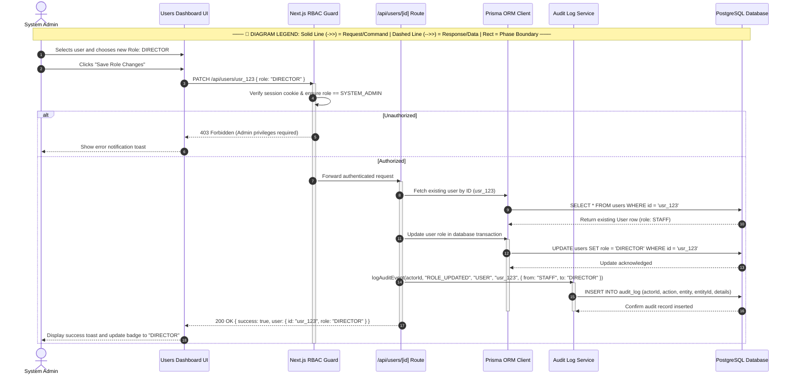

# System Admin — Sequence Diagram

> **Role:** `SYSTEM_ADMIN`  
> **Diagram Type:** Sequence Diagram  
> **Scenario:** Modifying User Institutional Role & Audit Trail Generation

---

## 1. Purpose

The Sequence Diagram shows the messages exchanged during an account role change. It traces validation, database modification, and audit log generation in chronological order.

---

## 2. Mermaid Sequence Diagram

---

## 3. Diagram Legend & Symbol Guide

| Visual / Symbol | Element Type | Technical Role | MinSU DocTrack Context |
|---|---|---|---|
| 👤 `actor` | Human Actor | External user role triggering system operations | Student Applicant, Staff Coordinator, Campus Director, Accounting Officer |
| 🔲 `participant` | System Component | Internal software subsystem or persistence boundary | Web UI, API Endpoint, Workflow Engine, Prisma/PostgreSQL, PDF Compiler |
| ──▶ `->>` | Solid Arrow | Synchronous invocation or command message | Submitting forms, verifying tokens, invoking database writes |
| - - ▷ `-->>` | Dashed Arrow | Return response or data payload | Confirmation slips, tracking codes, PDF binary buffers, query results |
| 🔲 `activate / deactivate` | Activation Lifeline | Period during which a component executes logic | Active request execution on API controllers or PDF engines |
| 🔲 `alt / else` | Conditional Fragment | Decision tree handling alternative workflow paths | Approval vs. Return branching, SLA compliance checks |

---

## 4. Sequence Steps

1. Admin selects a user on the dashboard and chooses a new role.
2. Admin submits the role modification.
3. Edge middleware verifies that the session belongs to a `SYSTEM_ADMIN`.
4. API loads the current user record to verify existence.
5. Database updates the user role to `DIRECTOR`.
6. Audit Log Service writes an immutable record capturing the role transition.
7. System returns confirmation to the UI and updates the badge.
