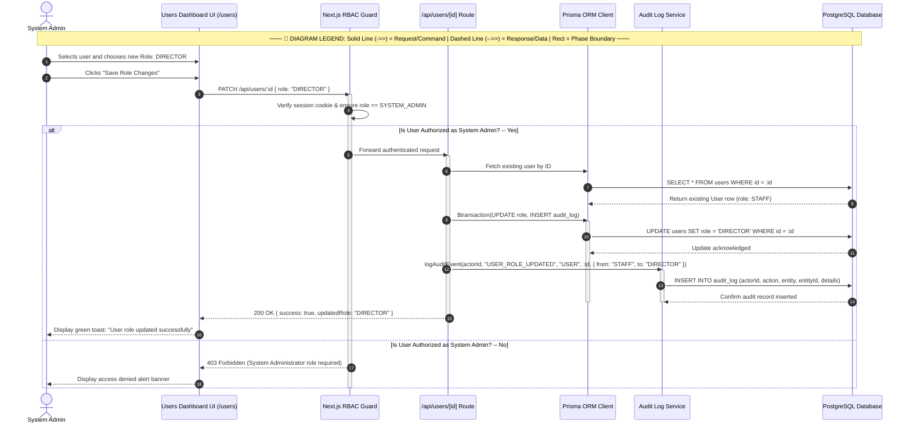

# System Admin — Sequence Diagram

> **Role:** `SYSTEM_ADMIN`  
> **Diagram Type:** Sequence Diagram  
> **Scenario:** Modifying User Role, 2FA Management, and Audit Trail Generation  
> **Standard:** UML 2.5 Sequence Specification

---

## 1. Purpose

The Sequence Diagram shows the messages exchanged in chronological order when the System Administrator updates an institutional user's role or resets 2FA security credentials. All decision branches evaluate strictly to binary Yes and No paths.

---

## 2. Mermaid Sequence Diagram

---

## 3. Diagram Legend & Symbol Guide

| Visual / Symbol | Element Type | Technical Role | MinSU DocTrack Context |
|---|---|---|---|
| `Actor` | Human User | Initiator of operational procedures | System Administrator provisioning user accounts |
| `Participant` | System Component | Boundary, controller, or data store | Users UI, RBAC Guard, Prisma ORM, PostgreSQL DB |
| `->>` | Synchronous Message | Command or method invocation | Patch user, verify session, commit database write |
| `-->>` | Return Message | Response data or confirmation payload | Returns 200 OK update payload or 403 Forbidden |
| `alt / else` | Conditional Frame | Guarded execution path (**Yes** / **No**) | Is User Authorized? Yes -> update; No -> reject |

---

## 4. Execution Sequence Steps

1. Admin selects a user on `/users` and chooses a new role.
2. Admin clicks "Save Role Changes".
3. Middleware evaluates session identity.
4. If authorized as System Admin (**Yes**), system executes the update inside an atomic transaction with audit logging.
5. If unauthorized (**No**), system returns HTTP 403 Forbidden and displays an access denied warning.
