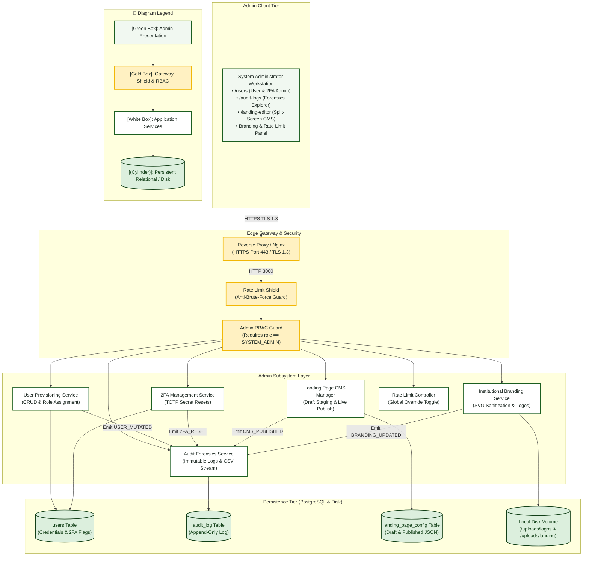

# System Admin — System Architecture Diagram

> **Role:** `SYSTEM_ADMIN`  
> **Diagram Type:** System Architecture Diagram  
> **Focus:** Administrative Governance, Rate Limiting, Audit Stores & Split-Screen CMS

---

## 1. Purpose

The System Architecture Diagram shows the multi-tier architecture used by the System Administrator, covering client presentation, edge rate limiting and RBAC gates, application governance services, and persistent storage tiers.

---

## 2. Mermaid System Architecture Diagram

---

## 3. Diagram Legend & Symbol Guide

| Visual Symbol | Syntax / Style | Tier Concept | MinSU Implementation |
|---|---|---|---|
| Client Tier | `#F1F8F1` Box | User Workstation Presentation | Next.js browser views for administrative governance |
| Edge Tier | `#FFF1C2` Box | Gateway, Shield & Authorization | Reverse proxy, IP rate limiter, `AdminRBAC` |
| Application Tier | `#FFFFFF` Box | Domain Services | User provisioning, 2FA management, CMS staging |
| Persistence Tier | Cylinder Shape | Relational & Disk Storage | PostgreSQL database and mounted logos file volume |

---

## 4. Tier Responsibilities

- **Client Tier**: Renders administrative dashboards, account creation modals, and the split-screen landing page editor.
- **Edge Tier**: Filters requests through IP-based brute-force tracking and verifies `SYSTEM_ADMIN` privilege.
- **Application Tier**: Enforces bcrypt credential hashing, handles TOTP secret resets, and writes immutable audit entries.
- **Persistence Tier**: Persists user profiles, audit logs, and sanitized SVG logos on secure host-mounted volumes.
