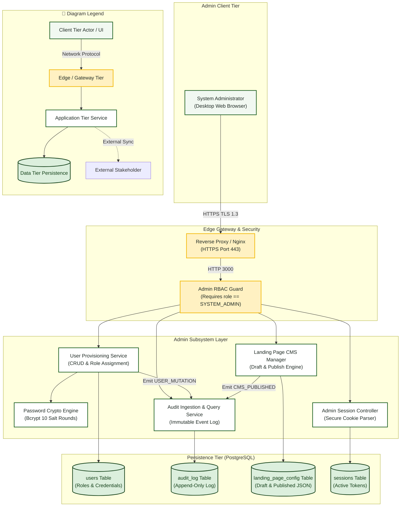

# System Admin — System Architecture Diagram

> **Role:** `SYSTEM_ADMIN`  
> **Diagram Type:** System Architecture Diagram  
> **Focus:** Administrative Governance Subsystem, Audit Stores & CMS Boundaries

---

## 1. Purpose

The System Architecture Diagram shows the main components of the administration subsystem. It shows the Admin browser, authentication layer, user provisioning services, immutable audit logger, and landing page CMS engine.

---

## 2. Mermaid System Architecture Diagram

---

## 3. Diagram Legend & Symbol Guide

| Visual Symbol | Syntax / Style | Architectural Tier | MinSU System Implementation |
|---|---|---|---|
| 🟩 Soft Green Box | `fill:#F1F8F1, stroke:#1B5E20` | Client Presentation Tier | Browser clients for Student, Staff, Director, Accounting, and Admin |
| 🟨 Gold Box | `fill:#FFF1C2, stroke:#F2B705` | Edge & Security Gateway Tier | Nginx TLS termination reverse-proxy and Next.js edge RBAC middleware |
| ⬜ White Box | `fill:#FFFFFF, stroke:#1B5E20` | Core Application Tier | Next.js Server Components, Document Engine, Auth Controller, PDF Compiler |
| 🟩 Dark Green Cylinder | `fill:#DCEFDD, stroke:#123F17` | Persistent Data Tier | PostgreSQL 16 relational database (Port 5432) and local storage volumes |
| ◻️ Dashed Border Box | `stroke-dasharray: 5 5` | External Stakeholder / Boundary | CHED/UniFAST regional office and external Google Drive transmittal archive |
| `-->` Solid Arrow | Network & Internal Call | Synchronous HTTPS, WSS, HTTP (port 3000), or TCP (port 5432) |
| `-.->` Dashed Arrow | Out-of-Band Integration | Physical courier shipment or external cloud drive URL synchronization |

---

## 4. Architecture Rules

- Only authenticated administrators with the `SYSTEM_ADMIN` role can reach administrative routes.
- The `Password Crypto Engine` hashes plain-text credentials before writing to the database.
- Administrative mutations must write an immutable audit log entry.
