# System Admin — Timing Diagram

> **Role:** `SYSTEM_ADMIN`  
> **Diagram Type:** Timing Diagram  
> **Scenario:** Administrative Session Expiration, 2FA Time-Steps & Rate Limit Lockout Windows  
> **Standard:** UML 2.5 Timing Specification

---

## 1. Purpose

The Timing Diagram shows the lifecycle states of administrative sessions, TOTP token validity intervals, anti-brute-force lockout windows, and audit log write latency constraints.

---

## 2. PlantUML Timing Diagram

```plantuml
@startuml
skinparam backgroundColor #FFFFFF
skinparam defaultFontName Arial

robust "Admin User Activity" as AdminAct
robust "Session & 2FA State" as SessState
concise "Rate Limit Window" as RateLimit
concise "Audit Ingestion" as AuditLog

@0
AdminAct is Active
SessState is Authenticating
RateLimit is Clear
AuditLog is Idle

@30
AdminAct is Active
SessState is Valid2FA
RateLimit is Clear
AuditLog is Idle
note bottom of SessState : RFC 6238 TOTP Verified (30s time step)

@60
AdminAct is MutatingConfig
SessState is Valid2FA
RateLimit is Clear
AuditLog is Recording
note bottom of AuditLog : Mutation Logged to PostgreSQL (<= 100ms)

@61
AuditLog is Idle

@70
AdminAct is Inactive
SessState is Valid2FA
RateLimit is Clear

@120
AdminAct is Inactive
SessState is Expired
RateLimit is Clear
note bottom of SessState : Inactivity Session Expiration Reached

@0 <-> @30 : {TOTP Token Step = 30 seconds}
@60 <-> @61 : {Audit Ingestion Latency <= 100ms}
@70 <-> @120 : {Max Inactivity Window = 50 minutes}

legend right
  <b>📌 DIAGRAM LEGEND & TIMING NOTATION</b>
  robust : Discrete operational state lifeline
  concise : Status bar indicating condition / SLA
  @N : Time tick offset in seconds/minutes
  @A <-> @B : Strict interval timing constraint
endlegend
@enduml
```

---

## 3. Diagram Legend & Symbol Guide

| Visual Symbol | Syntax / Style | UML Timing Concept | MinSU Implementation Context |
|---|---|---|---|
| Lifeline Wave | `robust "Name"` | Continuous state value of an entity | Admin Activity, Session & 2FA State |
| State Label | `Lifeline is STATE` | Active discrete status during interval | `AUTHENTICATING`, `VALID2FA`, `EXPIRED` |
| Timing Bar | `concise "Name"` | Qualitative status during interval | `Clear`, `Recording`, `Idle` |
| Interval Constraint | `@A <-> @B : {Label}` | Strict timing deadline or window | 30s TOTP step, 100ms audit write limit |

---

## 4. Timeline Milestones & Timing Rules

- **Second 0 to 30**: RFC 6238 time-step window for Microsoft Authenticator TOTP token verification.
- **Second 60**: Administrator modifies a user role; system commits the audit log within 100 milliseconds.
- **Minute 50 to 120**: Session inactivity limit; expires session token and requires re-authentication.
