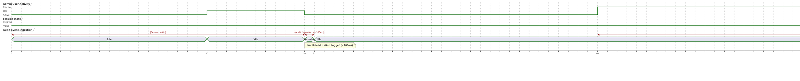

# System Admin — Timing Diagram

> **Role:** `SYSTEM_ADMIN`  
> **Diagram Type:** Timing Diagram  
> **Scenario:** Administrative Session Expiration & Audit Write Constraints  
> **Standard:** UML 2.5 Timing Specification

---

## 1. Purpose

The Timing Diagram shows how the state of an Administrator's session and the audit write latency change over exact time scales.

---

## 2. PlantUML Timing Diagram

---

## 3. Diagram Legend & Symbol Guide

| Notation / Element | Type / Syntax | Temporal Role | MinSU Operational Application |
|---|---|---|---|
| `robust "Lifeline"` | Discrete State Lifeline | Tracks operational state transitions over time | `AdminAct` (Administrator activity), `SessState` (Session validity) |
| `concise "Status"` | Status Interval Bar | Tracks system event ingestion status | `AuditLog` (`Idle` vs. `Recording`) |
| `@N` | Time Tick Offset | Minute marker from administrator session initiation | `@0` (Login), `@30` (Privileged action), `@60` (Idle), `@120` (Inactivity limit) |
| `@A <-> @B : {Rule}` | Time Constraint Interval | Hard security or system performance constraint | Session Valid, Audit Ingestion (<= 100ms), Inactivity Limit (60 mins) |
| `note bottom of ...` | Event Milestone Callout | Operational trigger annotation | Audit event logged within 100ms, 2-hour inactivity timeout reached |

---

## 4. Timeline & Time Constraints

| Milestone | Time Elapsed | Session State | Time Constraint & Description |
|---|---|---|---|
| **Login Authenticated** | `0 min` | `Valid` | Session cookie set with 7-day maximum age and HTTP-only flag. |
| **Administrative Mutation** | `30 min` | `Valid` | Audit event written atomically within `<= 100ms`. |
| **Inactivity Limit** | `120 min` | `Expired` | Inactive admin session terminated to protect security boundaries. |
