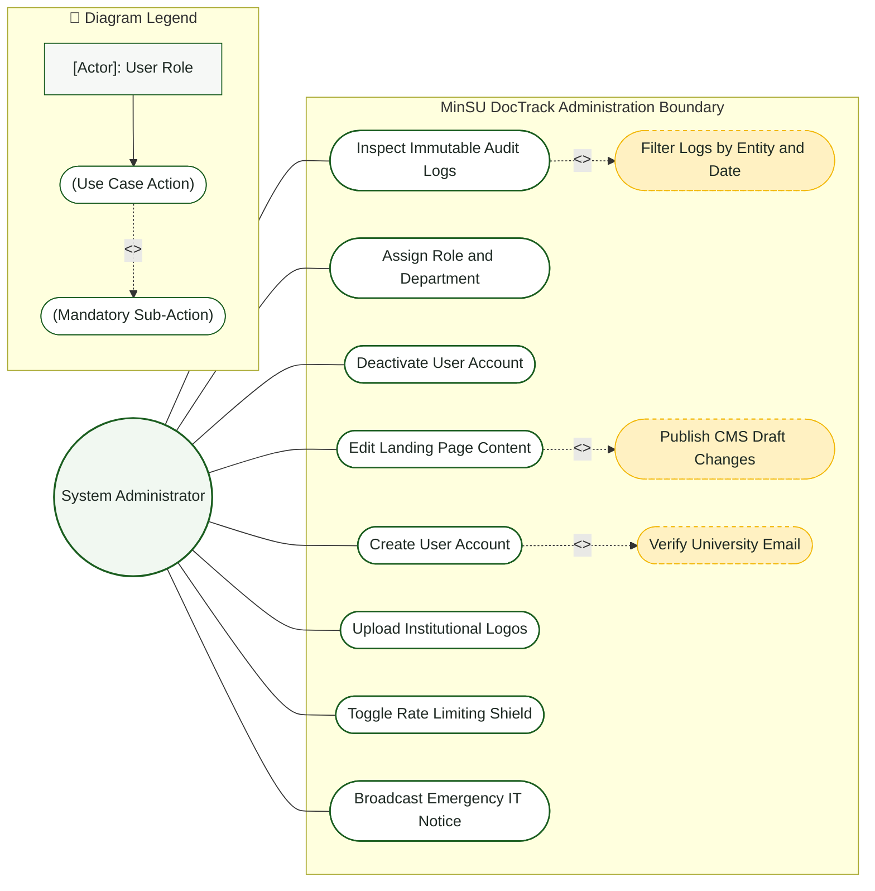
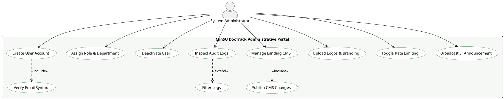

# System Admin — Use Case Diagram

> **Role:** `SYSTEM_ADMIN`  
> **Diagram Type:** Use Case Diagram  
> **Standard:** UML 2.5 Use Case Specification

---

## 1. Purpose

The Use Case Diagram shows what the System Administrator can do in MinSU DocTrack. It sets the boundary for user management, audit review, landing page CMS configuration, branding, rate limiting, and emergency announcements.

---

## 2. Mermaid Use Case Diagram

---

## 3. Diagram Legend & Symbol Guide

| Visual Symbol | Syntax / Style | UML Use Case Concept | MinSU System Implementation |
|---|---|---|---|
| `actor` / `[Actor]` | External Role | User triggering administrative actions | System Administrator |
| `usecase` / `(["(Action)"])` | Use Case Unit | Distinct capability or administrative goal | Create User, Toggle Rate Limits, Edit CMS, Inspect Audits |
| `-->` Solid Arrow | Actor Association | User initiates or receives data | Admin configures rate limits, manages logos, provisions users |
| `..>` / `-.->` Dashed Arrow | Stereotyped Dependency | Relationship between use cases | `<<include>>` (Mandatory invocation) or `<<extend>>` (Optional filter) |

---

## 4. PlantUML Use Case Diagram

