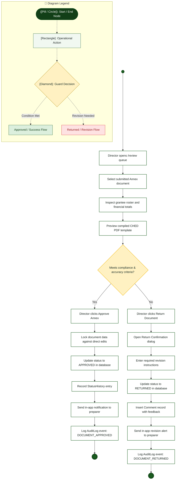

# Campus Director — Activity Diagram

> **Role:** `DIRECTOR`  
> **Diagram Type:** Activity Diagram  
> **Workflow:** Executive Review Queue Decision & Endorsement Workflow

---

## 1. Purpose

The Activity Diagram shows the step-by-step workflow when the Campus Director reviews submitted documents. It illustrates inspection, decision branching, approval locking, and return feedback.

---

## 2. Mermaid Activity Diagram

---

## 3. Diagram Legend & Symbol Guide

| Visual Symbol | Syntax / Node Type | Technical Role | MinSU Domain Meaning |
|---|---|---|---|
| `([Pill / Circle])` | `([Start / End])` / `(( ))` | Initial or terminal workflow boundary | Workflow entry point, queue initiation, terminal archive closure |
| `[Rectangle]` | `["Action"]` | Operational task or software routine | Inspecting forms, computing sums, generating receipt, updating status |
| `{Diamond}` | `{"Decision"}` | Mutually exclusive condition / guard | "Compliance verified?", "Variance == 0.00?", "Quota available?" |
| `──▶` | Solid Line `-->` | Sequential flow transition | Standard forward progression between operational activities |
| `-->|Label|` | Guarded Branch | Conditional execution path | "Yes / Approved", "No / Return with Remarks" |
| 🔲 Subgraph | `subgraph Lane` | Departmental Swimlane Boundary | Segregates duties across roles and authority boundaries |
| 🟢 Green Tone | `#DCEFDD` / `#1B5E20` | Approved State / Forward Flow | Validated submissions, executive approvals, zero-variance checks |
| 🟡 Gold Tone | `#FFF1C2` / `#B88A00` | Evaluation / Inspection Gate | Review queues, quota verification, decision checkpoints |
| 🔴 Red / Rose Tone | `#FEE2E2` / `#DC2626` | Return / Discrepancy Alert | Ineligible applications, returned documents, ledger adjustments |

---

## 4. Workflow Steps

1. Director navigates to `/review` on the dashboard.
2. Director selects a pending Annex document from the queue.
3. System presents the structured data table and financial calculations.
4. Director verifies grantee eligibility and peso balances against policy.
5. If valid, Director clicks "Approve Annex".
6. System locks the record, marks it `APPROVED`, and alerts the preparer.
7. If errors exist, Director opens the return dialog and provides feedback.
8. System updates the status to `RETURNED`, attaches comments, and alerts the preparer for revision.
