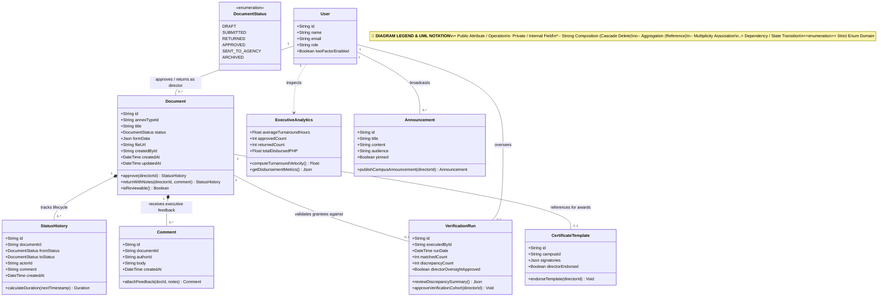

# Campus Director — Class Diagram

> **Role:** `DIRECTOR`  
> **Diagram Type:** Class Diagram  
> **Standard:** UML 2.5 Class Specification

---

## 1. Purpose

The Class Diagram shows the domain models, attributes, operations, and relationships governing executive review, 1-click approvals, returns with comments, verification oversight, certificate endorsements, and turnaround analytics.

---

## 2. Mermaid Class Diagram

---

## 3. Diagram Legend & Symbol Guide

| Symbol / UML Notation | Meaning & Syntax | Technical Function | MinSU Domain Example |
|---|---|---|---|
| `+` | Public Visibility | Readable attribute or callable method | `+approve()`, `+returnWithNotes()`, `+endorseTemplate()` |
| `-` | Private Visibility | Encapsulated field | Sensitive session tokens, internal metrics |
| `<<enumeration>>` | Enum Classifier | Strict closed set of categorical values | `DocumentStatus` (`SUBMITTED`, `APPROVED`, `RETURNED`) |
| `*--` | Strong Composition | Lifecycle containment (child deleted on parent deletion) | `Document *-- StatusHistory`, `Document *-- Comment` |
| `--` | Multiplicity Association | Association relationship between domain classes | One Director oversees many verification runs and documents |
| `..>` | Dependency | Usage or transition relationship | Director inspects `ExecutiveAnalytics` calculations |

---

## 4. Operations & Domain Rules

- `approve()` transitions document status to `APPROVED`, writes an immutable `StatusHistory` record, and notifies the preparer.
- `returnWithNotes()` transitions document status to `RETURNED`, requires a mandatory feedback comment, and unlocks the draft for revision.
- `approveVerificationCohort()` signs off on cross-matching accuracy before official Annex 4 submission.
- `endorseTemplate()` signs off on official signatories and layout dimensions for Annex 10 certificate generation.
