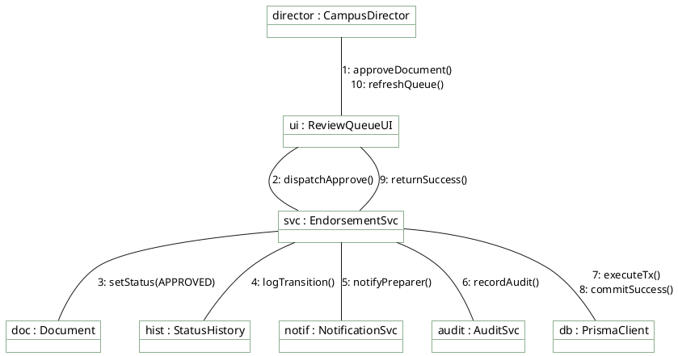

# Campus Director — Communication Diagram

> **Role:** `DIRECTOR`  
> **Diagram Type:** Communication Diagram  
> **Scenario:** Document Endorsement & Notification Dispatch  
> **Standard:** UML 2.5 Communication Specification

---

## 1. Purpose

The Communication Diagram shows the structural relationships and numbered message sequences during an executive document endorsement.

---

## 2. Mermaid Communication Diagram

```mermaid
flowchart LR
    %% Styling Classes
    classDef actorStyle fill:#F1F8F1,stroke:#1B5E20,stroke-width:2px,color:#1F2A24;
    classDef objStyle fill:#FFFFFF,stroke:#1B5E20,stroke-width:1.5px,color:#1F2A24;

    Director["director : CampusDirector"]:::actorStyle
    UI["ui : ReviewQueueView"]:::objStyle
    Service["service : EndorsementService"]:::objStyle
    Doc["doc : Document"]:::objStyle
    History["history : StatusHistory"]:::objStyle
    Notif["notif : NotificationService"]:::objStyle
    Audit["audit : AuditService"]:::objStyle
    DB["db : PrismaClient"]:::objStyle

    Director ---|1: approveDocument(docId)| UI
    UI ---|2: POST /api/documents/docId/approve| Service
    Service ---|3: lockAndSetStatus(APPROVED)| Doc
    Service ---|4: createTransitionEntry(SUBMITTED, APPROVED)| History
    Service ---|5: dispatchAlert(preparerId, 'Endorsed')| Notif
    Service ---|6: logAuditEvent(DOCUMENT_APPROVED)| Audit
    Service ---|7: executeAtomicTransaction()| DB
    DB ---|8: confirmTransactionCommit()| Service
    Service ---|9: 200 OK (Endorsement Confirmed)| UI
    UI ---|10: removeCardFromQueue()| Director

    %% ─── 📌 VISUAL LEGEND ───
    subgraph Legend ["📌 Diagram Legend"]
        direction TB
        L_Node["Node : Subsystem Component"]:::legNode
        L_Msg["Link: N: methodName(args)"]:::legMsg
        L_Node -->|Call Sequence| L_Msg
    end
    classDef legNode fill:#F1F8F1,stroke:#1B5E20,color:#1F2A24;
    classDef legMsg fill:#FFF1C2,stroke:#B88A00,color:#1F2A24;
```

---

## 3. Diagram Legend & Symbol Guide

| Element | Format / Syntax | Technical Meaning | MinSU Implementation Context |
|---|---|---|---|
| Subsystem Node | `[N: name : Class]` | Structural software participant | Controllers, Workflow Engines, Prisma Client, Storage Adapters |
| Link Connector | `-- "..." -->` | Directed communication channel | HTTP request, RPC method call, or database query |
| Numbered Prefix | `1:`, `2:`, `10:` | Chronological message sequence number | Sequential execution order from client event to persistence and UI update |
| Method Signature | `methodName(params)` | Invoked operation contract | `verifyRole(token)`, `checkVariance()`, `writeAuditLog()` |
| 🟢 Green Tone | `#F1F8F1` / `#1B5E20` | Core Subsystem Component | Institutional controllers, persistence adapters, and business engines |
| 🟡 Gold Tone | `#FFF1C2` / `#B88A00` | Guard & Dispatch Relay | Access guards, validation checks, and notification dispatchers |


---

## 4. PlantUML Communication Diagram



---

## 5. Numbered Message Steps

1. Director clicks "Approve Annex" on the review screen.
2. UI submits the approval request to the backend.
3. Service updates document status to `APPROVED` and locks data.
4. Service instantiates the `StatusHistory` transition entry.
5. Service prepares the in-app notification for the document's creator.
6. Service creates an immutable audit record.
7. Service commits all modifications inside a Prisma database transaction.
8. Database acknowledges commit.
9. Service returns HTTP 200 OK.
10. UI removes the document card from the pending review list.
