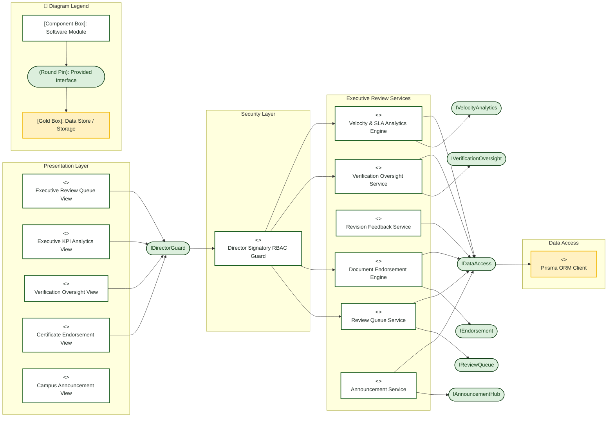

# Campus Director — Component Diagram

> **Role:** `DIRECTOR`  
> **Diagram Type:** Component Diagram  
> **Standard:** UML 2.5 Component Specification

---

## 1. Purpose

The Component Diagram shows the software modules, provided interfaces, and required dependencies within the executive review, verification oversight, and analytics subsystem.

---

## 2. Mermaid Component Diagram

---

## 3. Diagram Legend & Symbol Guide

| Visual Symbol | Syntax / Style | UML Component Meaning | MinSU Implementation |
|---|---|---|---|
| `[Component]` | `["<<component>>\nName"]` | Autonomous modular unit with internal logic | Endorsement Engine, Verification Oversight, Velocity Analytics |
| `(Interface)` | `(["IName"])` | Formal contract or API boundary | `IEndorsement`, `IVerificationOversight`, `IVelocityAnalytics` |
| `Solid Arrow` | `-->` | Direct dependency or communication invocation | Review views invoke endorsement operations via interfaces |
| `Data Component` | Gold Tone `#FFF1C2` | Persistence or storage component | Prisma ORM client adapter |

---

## 4. Component Responsibilities

- **Executive Review Queue View (`ReviewUI`)**: Provides 1-click approval and return modals with dynamic PDF previews.
- **Verification Oversight Service (`VerifyOversightService`)**: Permits executive inspection of tripartite matching results and discrepancy metrics before signing.
- **Document Endorsement Engine (`EndorsementService`)**: Applies cryptographic timestamps and transitions documents to `APPROVED`.
- **Velocity & SLA Analytics Engine (`AnalyticsService`)**: Computes campus approval velocities and 48-hour SLA metrics.
