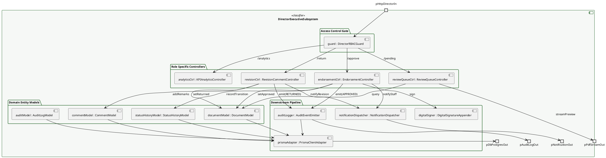

# Composite Structure Diagram: Campus Director Domain

> **Role:** `CAMPUS_DIRECTOR`  
> **Diagram Type:** Composite Structure Diagram  
> **Classifier:** `DirectorExecutiveSubsystem`

---

## 1. Purpose

This Composite Structure Diagram depicts the internal architecture of the `DirectorExecutiveSubsystem`. It shows how incoming executive commands pass through the director access gate to specific controllers, how controllers connect to document and revision models, and where data moves downstream to digital signature appenders, notification dispatchers, audit loggers, and database adapters.

---

## 2. Mermaid Composite Structure Diagram

```mermaid
flowchart TB
    %% Styling Classes
    classDef classifierStyle fill:#F6F8F6,stroke:#1B5E20,stroke-width:2.5px,color:#1F2A24
    classDef portStyle fill:#FFF1C2,stroke:#F2B705,stroke-width:2px,color:#1F2A24
    classDef guardStyle fill:#F1F8F1,stroke:#1B5E20,stroke-width:1.5px,color:#123F17
    classDef ctrlStyle fill:#EFF6FF,stroke:#2563EB,stroke-width:1.5px,color:#1E3A8A
    classDef modelStyle fill:#FAF5FF,stroke:#9333EA,stroke-width:1.5px,color:#581C87
    classDef svcStyle fill:#FEFCE8,stroke:#CA8A04,stroke-width:1.5px,color:#713F12
    classDef adapterStyle fill:#DCEFDD,stroke:#164D1C,stroke-width:2px,color:#123F17

    subgraph SUBSYSTEM["«classifier» DirectorExecutiveSubsystem"]
        direction TB

        %% Boundary Ingress Port
        pHttpDirectorIn["Port: pHttpDirectorIn<br/>(Director HTTPS Requests / API Routes)"]:::portStyle

        %% Layer 1: Security & RBAC Gate
        subgraph LAYER_SECURITY ["Access Control Gate"]
            guard["guard : DirectorRBACGuard<br/>• verifySessionToken()<br/>• enforceRole('CAMPUS_DIRECTOR')"]:::guardStyle
        end

        %% Layer 2: Role Specific Controllers
        subgraph LAYER_CONTROLLERS ["Role Specific Controllers"]
            reviewQueueCtrl["reviewQueueCtrl : ReviewQueueController<br/>• getPendingQueue()<br/>• filterByUrgency()<br/>• getSLAStatus()"]:::ctrlStyle

            endorsementCtrl["endorsementCtrl : EndorsementController<br/>• approveDocument()<br/>• stampDigitalSignature()<br/>• lockDocumentRecord()"]:::ctrlStyle

            revisionCtrl["revisionCtrl : RevisionCommentController<br/>• returnDocument()<br/>• attachRevisionComment()<br/>• reopenForEditing()"]:::ctrlStyle

            analyticsCtrl["analyticsCtrl : KPIAnalyticsController<br/>• getApprovalVelocity()<br/>• getTurnaroundMetrics()<br/>• evaluateComplianceScore()"]:::ctrlStyle
        end

        %% Layer 3: Domain Entity Models
        subgraph LAYER_MODELS ["Domain Entity Models"]
            documentModel["documentModel : DocumentModel<br/>- id: String<br/>- title: String<br/>- annexType: AnnexType<br/>- status: DocumentStatus<br/>- metadata: Json"]:::modelStyle

            statusHistoryModel["statusHistoryModel : StatusHistoryModel<br/>- id: String<br/>- documentId: String<br/>- fromStatus: 'SUBMITTED'<br/>- toStatus: 'APPROVED' | 'RETURNED'<br/>- remarks: String"]:::modelStyle

            commentModel["commentModel : CommentModel<br/>- id: String<br/>- documentId: String<br/>- userId: String<br/>- content: String"]:::modelStyle

            auditModel["auditModel : AuditLogModel<br/>- id: String<br/>- actorId: String<br/>- action: 'DOCUMENT_APPROVED'<br/>- entity: 'document'"]:::modelStyle
        end

        %% Layer 4: Downstream Services & Persistence ("Where it goes after")
        subgraph LAYER_DOWNSTREAM ["Downstream Pipeline & Event Emitters"]
            digitalSigner["digitalSigner : DigitalSignatureAppender<br/>• generateSignatureHash()<br/>• embedVerificationStamp()"]:::svcStyle

            notificationDispatcher["notificationDispatcher : NotificationDispatcher<br/>• notifyStaffAuthor()<br/>• notifyAccountingOffice()"]:::svcStyle

            auditLogger["auditLogger : AuditEventEmitter<br/>• emit('DOCUMENT_APPROVED')<br/>• emit('DOCUMENT_RETURNED')"]:::svcStyle

            prismaAdapter["prismaAdapter : PrismaClientAdapter<br/>• document.update()<br/>• statusHistory.create()<br/>• comment.create()<br/>• auditLog.create()"]:::adapterStyle
        end

        %% Boundary Egress Ports
        pDbPostgresOut["Port: pDbPostgresOut<br/>(PostgreSQL Connection Pool)"]:::portStyle
        pAuditLogOut["Port: pAuditLogOut<br/>(Append-Only Audit Sink)"]:::portStyle
        pNotificationOut["Port: pNotificationOut<br/>(Notification Broadcast Stream)"]:::portStyle
        pPdfStreamOut["Port: pPdfStreamOut<br/>(PDF Inspection Stream)"]:::portStyle

        %% Connectors: Ingress to Gate
        pHttpDirectorIn -->|"HTTPS /api/queue/*"| guard

        %% Gate to Controllers
        guard -->|"/api/documents/pending"| reviewQueueCtrl
        guard -->|"/api/documents/:id/approve"| endorsementCtrl
        guard -->|"/api/documents/:id/return"| revisionCtrl
        guard -->|"/api/analytics/director"| analyticsCtrl

        %% Controllers to Utilities & Models
        reviewQueueCtrl -->|"Fetch & Render PDF"| pPdfStreamOut
        reviewQueueCtrl -->|"Query Pending"| documentModel

        endorsementCtrl -->|"Generate Digital Stamp"| digitalSigner
        endorsementCtrl -->|"Update Status to APPROVED"| documentModel
        endorsementCtrl -->|"Record Approval Transition"| statusHistoryModel

        revisionCtrl -->|"Attach Director Comment"| commentModel
        revisionCtrl -->|"Update Status to RETURNED"| documentModel
        revisionCtrl -->|"Record Return Transition"| statusHistoryModel

        analyticsCtrl -->|"Compute Turnaround Metrics"| statusHistoryModel

        %% Models to Persistence Adapter
        documentModel -->|"Save Document State"| prismaAdapter
        statusHistoryModel -->|"Append Status Row"| prismaAdapter
        commentModel -->|"Save Revision Note"| prismaAdapter
        auditModel -->|"Write Audit Row"| prismaAdapter

        %% Controllers to Downstream Emitters
        endorsementCtrl -->|"Emit approval event"| auditLogger
        endorsementCtrl -->|"Alert preparer & accounting"| notificationDispatcher
        revisionCtrl -->|"Emit return event"| auditLogger
        revisionCtrl -->|"Alert preparer of revision"| notificationDispatcher

        %% Downstream Services to Ports
        auditLogger -->|"Persist audit row"| prismaAdapter
        auditLogger -->|"External SIEM stream"| pAuditLogOut
        notificationDispatcher -->|"Broadcast alerts"| pNotificationOut
        prismaAdapter -->|"SQL Transactions / Port 5432"| pDbPostgresOut
    end

    %% ─── 📌 VISUAL LEGEND ───
    subgraph LEGEND ["📌 Diagram Legend"]
        direction TB
        L_Class["<<classifier>><br/>Encapsulating Unit"]:::classifierStyle
        L_Port["Port: pName<br/>(Interface Gate)"]:::portStyle
        L_Part["part : InternalComponent"]:::ctrlStyle
        L_Port -->|Delegation| L_Part
    end
```

---

## 3. PlantUML Alternative Syntax

---

## 4. Diagram Legend & Symbol Guide

| Visual Symbol | Syntax / Style | UML Structural Role | MinSU System Implementation |
|---|---|---|---|
| Outer Classifier | `subgraph SUBSYSTEM` (`#F6F8F6`) | Encapsulating software unit | `DirectorExecutiveSubsystem` governing review queue & approvals |
| 🟨 Port Node | `pName` (`#FFF1C2` / `#F2B705`) | Interaction boundary / gate | Inbound Director HTTP, database connection, PDF preview, notifications |
| 🟩 Green Box | `guard : Class` (`#F1F8F1` / `#1B5E20`) | Security & RBAC Gatekeeper | Verifies session token belongs to `CAMPUS_DIRECTOR` |
| 🟦 Blue Box | `ctrl : Class` (`#EFF6FF` / `#2563EB`) | Role-Specific Controller | Queue loader, 1-click endorsement, revision return, KPI calculator |
| 🟪 Purple Box | `model : Class` (`#FAF5FF` / `#9333EA`) | In-Memory Domain Model | Document, status transition history, revision comment, audit log |
| 🟨 Yellow Box | `service : Class` (`#FEFCE8` / `#CA8A04`) | Downstream Utility / Service | Digital signature appender, notification dispatcher, audit emitter |
| 🟩 Dark Green Box | `adapter : Class` (`#DCEFDD` / `#164D1C`) | Persistence Client Adapter | Prisma client executing atomic status and history commits |
| `-->` Connector | Solid Arrow | Internal message flow | Directed method calls, signature signing, and event emissions |

---

## 5. Parts, Ports, and Connectors Table

### 5.1 Boundary Ports
| Port Name | Direction | Interface / Protocol | Responsibility |
|---|---|---|---|
| `pHttpDirectorIn` | Inbound | HTTPS (JSON / REST) | Ingests Campus Director approval, return, and queue inspection requests. |
| `pDbPostgresOut` | Outbound | TCP / SQL (Port 5432) | Connects to PostgreSQL database via Prisma connection pooling. |
| `pAuditLogOut` | Outbound | Event Stream | Transmits immutable audit log records to external compliance monitors. |
| `pNotificationOut` | Outbound | WebSocket / In-App | Sends alerts to staff coordinators and accounting officers when documents update. |
| `pPdfStreamOut` | Outbound | Binary PDF Stream | Streams compiled Annex documents to the director's browser for preview inspection. |

### 5.2 Subsystem Controllers
| Controller Part | Concrete File | Key Responsibilities |
|---|---|---|
| `reviewQueueCtrl : ReviewQueueController` | `src/app/api/documents/route.ts` | Retrieves documents with `SUBMITTED` status, sorts by submission timestamp, flags 48h SLA warnings. |
| `endorsementCtrl : EndorsementController` | `src/app/api/documents/[id]/route.ts` | Validates signatory authority, stamps digital endorsement, changes status to `APPROVED`, locks record. |
| `revisionCtrl : RevisionCommentController` | `src/app/api/documents/[id]/route.ts` | Captures feedback remarks, changes status to `RETURNED`, unlocks document for author corrections. |
| `analyticsCtrl : KPIAnalyticsController` | `src/app/api/analytics/director/route.ts` | Calculates average turnaround hours, approval-to-return ratios, and SLA compliance percentages. |

### 5.3 Domain Entity Models
| Model Part | Prisma Entity | Core Attributes Captured |
|---|---|---|
| `documentModel : DocumentModel` | `Document` | `id`, `title`, `annexType`, `status`, `createdById`, `metadata`, `updatedAt`. |
| `statusHistoryModel : StatusHistoryModel` | `StatusHistory` | `id`, `documentId`, `fromStatus`, `toStatus`, `changedById`, `remarks`. |
| `commentModel : CommentModel` | `Comment` | `id`, `documentId`, `userId`, `content`, `createdAt`. |
| `auditModel : AuditLogModel` | `AuditLog` | `id`, `actorId`, `action`, `entity`, `entityId`, `details`. |

### 5.4 Downstream Pipeline ("Where It Goes After")
| Downstream Part | Technology / Module | Action Taken After Controller / Model Mutation |
|---|---|---|
| `digitalSigner : DigitalSignatureAppender` | `src/lib/auth.ts` | Cryptographically signs the document with director ID, timestamp, and verification hash. |
| `notificationDispatcher : NotificationDispatcher` | `src/lib/notifications.ts` | Alerts staff authors immediately when documents are approved or returned with comments. |
| `auditLogger : AuditEventEmitter` | `src/lib/audit.ts` | Emits immutable `DOCUMENT_APPROVED` or `DOCUMENT_RETURNED` audit logs. |
| `prismaAdapter : PrismaClientAdapter` | `src/lib/prisma.ts` | Executes status update and history append inside an atomic database transaction. |

---

## 6. STE Rules Applied

- The diagram focuses on one classifier: the `DirectorExecutiveSubsystem`.
- External interactions enter and exit through clearly named ports.
- Sentences contain 25 words or fewer.
- Instructions start with imperative verbs.
