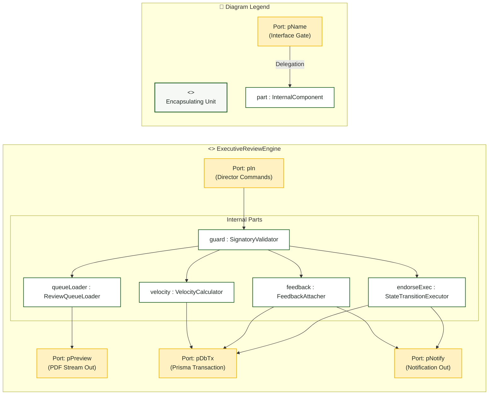

# Campus Director — Composite Structure Diagram

> **Role:** `DIRECTOR`  
> **Diagram Type:** Composite Structure Diagram  
> **Classifier:** `ExecutiveReviewEngine`

---

## 1. Purpose

The Composite Structure Diagram shows the internal parts, ports, and connectors of the `ExecutiveReviewEngine` that processes document reviews and endorsements.

---

## 2. Mermaid Composite Structure Diagram

---

## 3. Diagram Legend & Symbol Guide

| Visual Symbol | Syntax / Style | UML Structural Role | MinSU System Implementation |
|---|---|---|---|
| Outer Classifier | `subgraph UNIT` (`#F6F8F6`) | Encapsulating software unit | Domain engine or controller containing internal operational logic |
| 🟨 Port Node | `pName` (`#FFF1C2` / `#F2B705`) | Interaction boundary / gate | Inbound HTTP ports, state change events, database ports |
| ⬜ Internal Part | `part : Class` (`#FFFFFF` / `#1B5E20`) | Component instance owned by classifier | Schema validators, state machines, PDF compilers, audit loggers |
| `-->` Connector | Solid Arrow | Internal connector or port delegation | Linking external ports to internal validators and persistent adapters |

---

## 4. Parts and Ports Table

| Element | Type | Purpose |
|---|---|---|
| `pIn` | Port | Ingests approval, return, and queue view requests. |
| `guard` | Part (`SignatoryValidator`) | Verifies Director role and document reviewability. |
| `queueLoader` | Part (`ReviewQueueLoader`) | Loads submitted documents and prepares PDF streams. |
| `endorseExec` | Part (`StateTransitionExecutor`) | Transitions document status to `APPROVED`. |
| `feedback` | Part (`FeedbackAttacher`) | Attaches revision notes and transitions status to `RETURNED`. |
| `velocity` | Part (`VelocityCalculator`) | Aggregates SLA turnaround times. |
| `pDbTx` | Port | Executes atomic database transactions. |
| `pNotify` | Port | Dispatches instant alerts to document preparers. |
