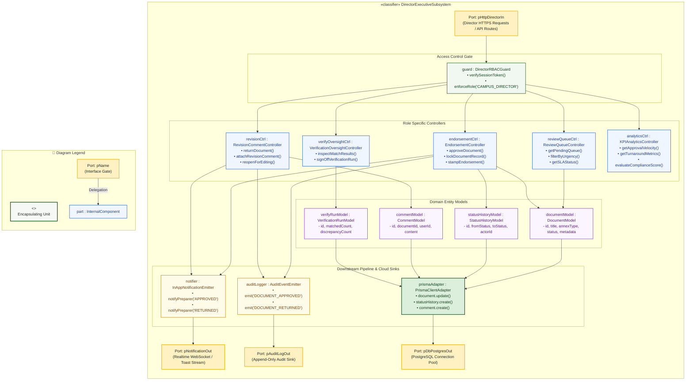

# Composite Structure Diagram: Campus Director Domain

> **Role:** `CAMPUS_DIRECTOR`  
> **Diagram Type:** Composite Structure Diagram  
> **Classifier:** `DirectorExecutiveSubsystem`

---

## 1. Purpose

This Composite Structure Diagram depicts the internal architecture of the `DirectorExecutiveSubsystem`. It shows how incoming executive commands pass through the director access gate to controllers for review, endorsement, verification oversight, and KPI analytics, connecting downstream to database adapters and notification emitters.

---

## 2. Mermaid Composite Structure Diagram

---

## 3. Diagram Legend & Symbol Guide

| Symbol | UML Concept | Technical Function | MinSU Operational Meaning |
|---|---|---|---|
| `«classifier»` | Subsystem Classifier | Encapsulates internal structural parts | `DirectorExecutiveSubsystem` |
| `Port` | Port Boundary | Ingress/egress interaction gate | HTTP Ingress, Notification Out, PostgreSQL DB Out |
| `part` | Internal Component Part | Role controller or internal service | `EndorsementController`, `KPIAnalyticsController` |
| `-->` | Connector | Structural delegation or data flow | Routes authorized commands to downstream persistence |
