# Campus Director — Data Flow Diagram (DFD)

> **Role:** `DIRECTOR`  
> **Diagram Type:** Data Flow Diagram (Level 1)  
> **Focus:** Review Queue Ingestion, Endorsement Updates, Verification Oversight, and Analytics

---

## 1. Purpose

The Data Flow Diagram shows how submitted Annex records, tripartite verification cohorts, and executive decisions flow through Director processes to data stores and notification streams.

---

## 2. Mermaid Data Flow Diagram (Level 1)

```mermaid
flowchart TD
    %% Styling Classes
    classDef entityStyle fill:#F1F8F1,stroke:#1B5E20,stroke-width:2px,color:#1F2A24;
    classDef processStyle fill:#FFFFFF,stroke:#1B5E20,stroke-width:2px,color:#1F2A24;
    classDef storeStyle fill:#FFF1C2,stroke:#F2B705,stroke-width:2px,color:#1F2A24;

    DirectorEntity["Campus Director<br/>(External Entity)"]:::entityStyle
    PreparerEntity["Document Preparer<br/>(Staff / Accounting)"]:::entityStyle

    subgraph PROCESSES["Review Subsystem Processes"]
        P1["1.0<br/>Load Pending Review Queue"]:::processStyle
        P2["2.0<br/>Inspect Annex Data & Verification Results"]:::processStyle
        P3["3.0<br/>Execute Executive Endorsement"]:::processStyle
        P4["4.0<br/>Return with Revision Feedback"]:::processStyle
        P5["5.0<br/>Oversee Verification Cohorts"]:::processStyle
        P6["6.0<br/>Aggregate Velocity Analytics"]:::processStyle
    end

    subgraph DATA_STORES["Data Stores"]
        D1[("D1: documents Table")]:::storeStyle
        D2[("D2: status_history Table")]:::storeStyle
        D3[("D3: comments Table")]:::storeStyle
        D4[("D4: verification_runs Table")]:::storeStyle
        D5[("D5: notifications Table")]:::storeStyle
        D6[("D6: audit_log Table")]:::storeStyle
    end

    %% Flows from Director
    DirectorEntity -->|Review Request Filter| P1
    DirectorEntity -->|Select Document ID| P2
    DirectorEntity -->|1-Click Approve Command| P3
    DirectorEntity -->|Return Command & Comments| P4
    DirectorEntity -->|Sign-Off Verification Run| P5
    DirectorEntity -->|Query Analytics Range| P6

    %% Flows to Director
    P1 -->|Pending Document Roster| DirectorEntity
    P2 -->|Structured Data & Cross-Match Status| DirectorEntity
    P3 -->|Endorsement Confirmation Toast| DirectorEntity
    P4 -->|Return Acknowledgment| DirectorEntity
    P5 -->|Discrepancy Breakdown Metrics| DirectorEntity
    P6 -->|Velocity KPIs & Turnaround Charts| DirectorEntity

    %% Data Store Movements
    D1 -->|Query SUBMITTED Documents| P1
    D1 -->|Read Form Data & Signatories| P2
    D4 -->|Read Matching Statistics| P2
    P3 -->|UPDATE status = 'APPROVED'| D1
    P3 -->|INSERT History Row| D2
    P3 -->|Audit: DOCUMENT_APPROVED| D6
    P3 -->|Send Notification| D5
    D5 -->|Alert: Document Approved| PreparerEntity

    P4 -->|UPDATE status = 'RETURNED'| D1
    P4 -->|INSERT History Row| D2
    P4 -->|INSERT Feedback Row| D3
    P4 -->|Audit: DOCUMENT_RETURNED| D6
    P4 -->|Send Revision Alert| D5
    D5 -->|Alert: Revisions Required| PreparerEntity

    P5 -->|Sign-Off Cohort| D4
    D2 -->|Fetch Timestamps & Durations| P6

    %% ─── 📌 VISUAL LEGEND ───
    subgraph Legend ["📌 Diagram Legend"]
        direction TB
        L_Ent["[Square]: External Entity"]:::entityStyle
        L_Proc["(Circle / Rounded): Process Step"]:::processStyle
        L_Store[("[(Cylinder)]: Data Store")]:::storeStyle
        L_Ent -->|Data Flow| L_Proc -->|Storage Flow| L_Store
    end
```

---

## 3. Diagram Legend & Symbol Guide

| Visual Symbol | Syntax / Style | DFD Concept | MinSU Implementation |
|---|---|---|---|
| `[Entity]` | `["Name"]` | External Source or Sink | Campus Director, Document Preparer |
| `(Process)` | `["N.0\nName"]` | Transformation of data packets | Review queue ingestion, endorsement, SLA computation |
| `[(Data Store)]` | `[("DN: table")]` | Relational database table | PostgreSQL tables (`documents`, `verification_runs`, `status_history`) |
| `-->` | Directed Arrow | Flow of structured data | Approvals, return comments, turnaround charts |

---

## 4. Data Flow Descriptions

- **1.0 Load Pending Review Queue**: Filters `documents` by `status = 'SUBMITTED'` and calculates SLA urgency badges.
- **2.0 Inspect Annex Data & Verification Results**: Retrieves form payloads, grantee masterlists, and tripartite cross-match status.
- **3.0 Execute Executive Endorsement**: Updates status to `APPROVED`, writes history, emits audit event, and alerts the preparer.
- **4.0 Return with Revision Feedback**: Unlocks document with `RETURNED` status and stores required comments for staff/accounting.
- **5.0 Oversee Verification Cohorts**: Allows director review of discrepancy percentages before official billing approval.
- **6.0 Aggregate Velocity Analytics**: Computes average turnaround duration in hours against the 48-hour SLA benchmark.
