# Campus Director — Data Flow Diagram (DFD)

> **Role:** `DIRECTOR`  
> **Diagram Type:** Data Flow Diagram (Level 1)  
> **Focus:** Review Queue Ingestion, Endorsement Updates & Analytics Data Flow

---

## 1. Purpose

The Data Flow Diagram shows how submitted document records move through executive review processes to data stores and outbound notification streams.

---

## 2. Mermaid Data Flow Diagram (Level 1)

```mermaid
flowchart TD
    %% Styling Classes
    classDef entityStyle fill:#F1F8F1,stroke:#1B5E20,stroke-width:2px,color:#1F2A24;
    classDef processStyle fill:#FFFFFF,stroke:#1B5E20,stroke-width:2px,color:#1F2A24;
    classDef storeStyle fill:#FFF1C2,stroke:#F2B705,stroke-width:2px,color:#1F2A24;

    DirectorEntity["Campus Director<br/>(External Entity)"]:::entityStyle
    PreparerEntity["Document Preparer<br/>(Staff / Accounting)"]:::entityStyle

    subgraph PROCESSES["Review Subsystem Processes"]
        P1["1.0<br/>Load Pending Review Queue"]:::processStyle
        P2["2.0<br/>Inspect Annex Data & Totals"]:::processStyle
        P3["3.0<br/>Execute Endorsement"]:::processStyle
        P4["4.0<br/>Return with Revision Notes"]:::processStyle
        P5["5.0<br/>Aggregate Velocity Analytics"]:::processStyle
    end

    subgraph DATA_STORES["Data Stores"]
        D1[("D1: documents Table")]:::storeStyle
        D2[("D2: status_history Table")]:::storeStyle
        D3[("D3: comments Table")]:::storeStyle
        D4[("D4: notifications Table")]:::storeStyle
        D5[("D5: audit_log Table")]:::storeStyle
    end

    %% Flows from Director
    DirectorEntity -->|Review Request Filter| P1
    DirectorEntity -->|Selection ID| P2
    DirectorEntity -->|Approve Action Command| P3
    DirectorEntity -->|Return Command & Comments| P4
    DirectorEntity -->|Analytics Date Range Query| P5

    %% Flows to Director
    P1 -->|Pending Document Roster| DirectorEntity
    P2 -->|Structured Data & PDF Stream| DirectorEntity
    P3 -->|Endorsement Confirmation| DirectorEntity
    P4 -->|Return Confirmation| DirectorEntity
    P5 -->|Velocity KPIs & Charts| DirectorEntity

    %% Data Store Movements
    D1 -->|Query SUBMITTED / RESUBMITTED| P1
    D1 -->|Read Full JSON Form Payload| P2

    P3 -->|Update Status: APPROVED| D1
    P3 -->|Insert APPROVED Transition| D2
    P3 -->|Insert Approval Alert| D4
    P3 -->|Write Action Event| D5

    P4 -->|Update Status: RETURNED| D1
    P4 -->|Insert RETURNED Transition| D2
    P4 -->|Insert Revision Feedback| D3
    P4 -->|Insert Revision Alert| D4
    P4 -->|Write Action Event| D5

    D2 -->|Read Timestamps for SLA| P5
    D1 -->|Read Status Counts| P5

    %% Preparer Notifications
    D4 -.->|Stream In-App Alert| PreparerEntity

    %% ─── 📌 VISUAL LEGEND ───
    subgraph Legend ["📌 Diagram Legend"]
        direction TB
        L_Ent["[Square]: External Entity"]:::legEnt
        L_Proc["1.0 [Box]: Process"]:::legProc
        L_Store[("[(Cylinder)]: Data Store")]:::legStore
        L_Ent -->|Data Flow Payload| L_Proc
        L_Proc -->|Data Mutation| L_Store
    end
    classDef legEnt fill:#FFFFFF,stroke:#123F17,color:#1F2A24;
    classDef legProc fill:#F1F8F1,stroke:#1B5E20,color:#1F2A24;
    classDef legStore fill:#FFF1C2,stroke:#F2B705,color:#1F2A24;
```

---

## 3. Diagram Legend & Symbol Guide

| DFD Element Shape | Gane & Sarson / Yourdon Notation | Technical Role | MinSU System Implementation |
|---|---|---|---|
| `[Rectangle]` | External Entity | Source or sink outside the process boundary | Students, Staff Coordinator, Campus Director, Accounting, CHED Agency |
| `(("((Double Circle))"))` | Context Process (Level 0) | Top-level system boundary | Entire MinSU DocTrack system |
| `["1.0 Process"]` | Operational Process (Level 1) | Data transformation or business logic step | Intake Applications, Validate Annexes, Executive Review, Financials |
| `[("[(Cylinder)]")]` | Persistent Data Store | Relational table or permanent data repository | Users & Sessions, Applications, Documents, Transmittals, Audit Logs |
| `-->|Data Flow|` | Named Flow Arrow | In-transit data packet or payload | Forms, tracking codes, financial records, audit rows |
| 🟢 Green Box | Process Node | Active workflow processing unit | Core backend services and transaction coordinators |
| 🟨 Gold Cylinder | Data Store Node | Persistent PostgreSQL / File store | Secure database tables with RLS and foreign key integrity |

---

## 4. Data Dictionary

- **Review Request Filter**: Optional campus department or Annex type criteria.
- **Pending Document Roster**: List of documents awaiting executive decision.
- **Approve Action Command**: Cryptographically signed confirmation to transition status to `APPROVED`.
- **Return Command & Comments**: Text instructions detailing required corrections.
- **Velocity KPIs & Charts**: Calculated mean turnaround hours and status distribution counts.
