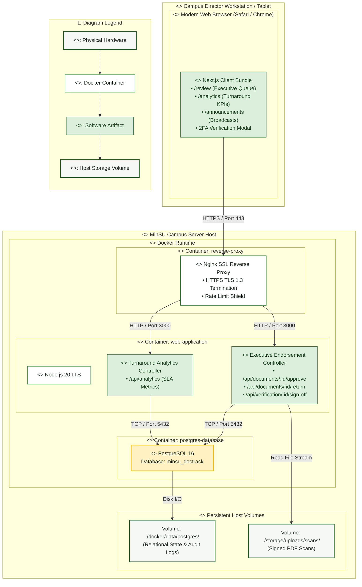

# Campus Director — Deployment Diagram

> **Role:** `DIRECTOR`  
> **Diagram Type:** Deployment Diagram  
> **Standard:** UML 2.5 Deployment Specification

---

## 1. Purpose

The Deployment Diagram shows the physical devices, execution containers, network connections, and runtime software artifacts supporting the Campus Director review queue and analytics dashboard.

---

## 2. Mermaid Deployment Diagram

---

## 3. Diagram Legend & Symbol Guide

| Visual Symbol | Syntax / Style | UML Deployment Concept | MinSU Implementation |
|---|---|---|---|
| `<<device>>` | Double Bracket Box | Physical hardware machine | Director Workstation / iPad, Campus Server Host |
| `<<node>>` | Container Box | Virtualized service environment | Reverse proxy, Node.js web application, PostgreSQL |
| `<<artifact>>` | Shaded Component | Executable software code or bundle | Next.js review SPA, executive controllers, analytics route |
| `<<storage>>` | File Volume Box | Block storage volume | PostgreSQL database directory, scanned PDFs storage |

---

## 4. Deployment Specifications

- **Director Device**: Optimized for desktop browsers and tablet touch interfaces with responsive PDF rendering.
- **Reverse Proxy**: Enforces TLS 1.3 encryption and validates session cookies before reaching the application container.
- **Web Application Container**: Houses the review and return controller, enforcing that only `CAMPUS_DIRECTOR` roles can execute endorsement operations.
- **Database Container**: Stores tamper-evident `status_history` and `audit_log` records on a persistent volume mount.
