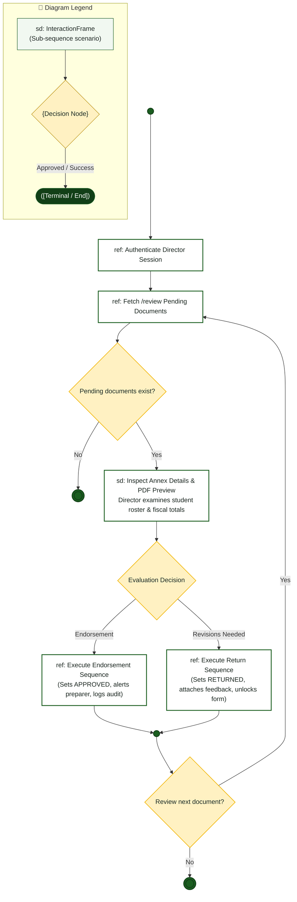

# Campus Director — Interaction Overview Diagram

> **Role:** `DIRECTOR`  
> **Diagram Type:** Interaction Overview Diagram  
> **Workflow:** Executive Review & Endorsement Orchestration

---

## 1. Purpose

The Interaction Overview Diagram joins high-level activity control flow with sequence interaction frames. It shows the control flow between distinct review operations.

---

## 2. Interaction Overview Diagram

---

## 3. Diagram Legend & Symbol Guide

| Symbol / Element | Syntax / Type | Technical Meaning | MinSU Interaction Context |
|---|---|---|---|
| `sd: FrameName` | `["sd: ..."]` | Sequence interaction scenario frame | Encapsulates an entire sequence scenario (e.g., `Authenticate`, `ReviewQueue`) |
| `{Decision}` | `{"Decision"}` | Activity decision branch point | Critical decision gate (e.g., approval vs. return, variance check) |
| `([Pill Node])` | `([Start / End])` | Lifecycle start or terminal archive node | Initiating semester operations or locking final records in archive |
| `-->` Solid Arrow | Control Flow Connector | Sequential hand-off between frames | Passing control from one interaction frame to the next |
| `-->|Label|` | Guarded Branch | Conditional scenario path | "Yes: Approved", "No: Discrepancy", "Return with Remarks" |
| 🟢 Green Box | `#F1F8F1` / `#1B5E20` | Successful Workflow Phase | Forward operational processing and executive approval |
| 🟡 Gold Diamond | `#FFF1C2` / `#B88A00` | Institutional Checkpoint | Evaluation queue and zero-variance fiscal math check |

---

## 4. Interaction Stages & References

| Stage Frame | Diagram Type | Reference Link | Purpose |
|---|---|---|---|
| `Authenticate Director Session` | Sequence (`ref`) | System Auth | Validates session token and verifies `DIRECTOR` privileges. |
| `Fetch /review Pending Documents` | Sequence (`ref`) | Document Service | Loads documents with status `SUBMITTED` or `RESUBMITTED`. |
| `Inspect Annex Details & PDF Preview` | Inline (`sd`) | Review UI | Displays structured roster and compiles visual PDF preview. |
| `Execute Endorsement Sequence` | Sequence (`ref`) | [`sequence-diagram.md`](file:///c:/Users/Paolo%20Amor%20P.%20Palma/Desktop/NICKO/docs/diagrams/director/sequence-diagram.md) | Executes 1-click approval transaction and notifies preparer. |
| `Execute Return Sequence` | Sequence (`ref`) | [`sequence-diagram.md`](file:///c:/Users/Paolo%20Amor%20P.%20Palma/Desktop/NICKO/docs/diagrams/director/sequence-diagram.md) | Captures revision comments, updates status, and unlocks form. |

---

## 5. STE Rules Applied

- The diagram uses standard control flow symbols with nested interaction frames.
- Guard conditions on decision diamonds are mutually exclusive.
- Each branch resolves to a final node.
