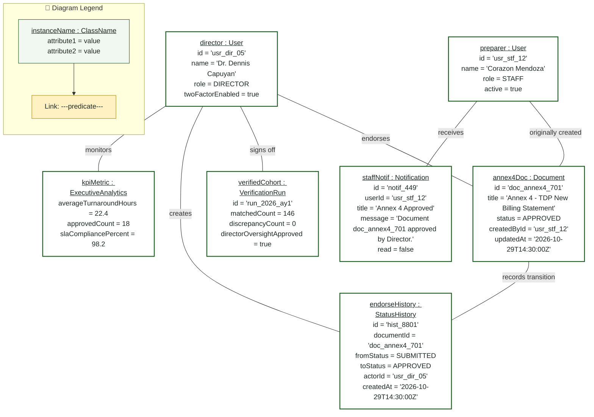

# Campus Director — Object Diagram

> **Role:** `DIRECTOR`  
> **Diagram Type:** Object Diagram  
> **Scenario:** Runtime Snapshot of Annex 4 Endorsement & Verification Sign-Off  
> **Standard:** UML 2.5 Object Specification

---

## 1. Purpose

The Object Diagram shows a concrete runtime snapshot of an executive endorsement, 3-way verification sign-off, and status transition executed by the Campus Director.

---

## 2. Mermaid Object Diagram

---

## 3. Diagram Legend & Symbol Guide

| Visual Symbol | Syntax / Format | UML Role | MinSU Instance Context |
|---|---|---|---|
| `<u>instance : Class</u>` | Underlined Identifier | Concrete runtime object in memory | Campus Director, verified cohort, approved Annex document |
| `attr = 'value'` | Key-Value Assignment | Concrete state of instance properties | `status = 'APPROVED'`, `directorOversightApproved = true` |
| `---predicate---` | Undirected Semantic Link | Association relationship at runtime | Director endorses document, signs off verification run |
| 🟢 Green Container | `#1B5E20` / `#F1F8F1` | Approved Domain Entity | Executive approval record with 22.4-hour turnaround velocity |

---

## 4. Runtime Object Attributes

- `director`: Authenticated executive with active two-factor authentication.
- `annex4Doc`: Official billing document transitioned from `SUBMITTED` to `APPROVED`.
- `verifiedCohort`: 3-way cross-matched student roster signed off with zero unresolved discrepancies.
- `endorseHistory`: Audit record capturing actor ID, timestamp, and transition state.
- `kpiMetric`: Performance calculation showing an average turnaround time of 22.4 hours (well within 48h SLA).
