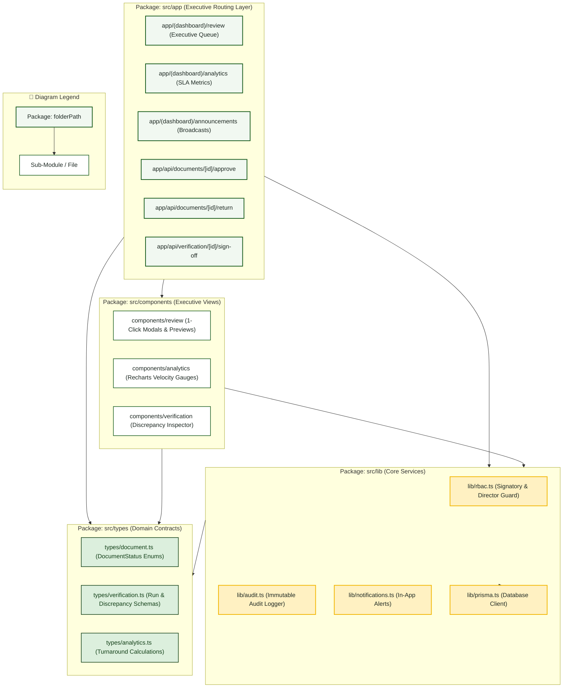

# Campus Director — Package Diagram

> **Role:** `DIRECTOR`  
> **Diagram Type:** Package Diagram  
> **Standard:** UML 2.5 Package Specification

---

## 1. Purpose

The Package Diagram shows the codebase packages, UI modules, and domain services that implement the executive review, verification oversight, and KPI analytics subsystem.

---

## 2. Mermaid Package Diagram

---

## 3. Diagram Legend & Symbol Guide

| Visual Symbol | Syntax / Style | UML Package Concept | MinSU Implementation |
|---|---|---|---|
| `subgraph Pkg` | Folder Container | Architectural Namespace or Directory | `src/app`, `src/components`, `src/lib`, `src/types` |
| `[Module]` | Rectangle with border | Concrete file or sub-package | `review/page.tsx`, `analytics/page.tsx`, `rbac.ts` |
| `-->` | Directed Dependency | Import or invocation relationship | Executive routes import review components and RBAC guards |
| 🟢 Green Tone | `#F1F8F1` / `#1B5E20` | Executive Routing & UI Modules | Director pages and approval action routes |

---

## 4. Package Organization & Separation of Concerns

- **`src/app`**: Exposes protected executive routes (`/review`, `/analytics`, `/announcements`) guarded by `CAMPUS_DIRECTOR` role validation.
- **`src/components`**: Contains interactive review queue tables, document return confirmation dialogs, and Recharts KPI graphs.
- **`src/lib`**: Houses the core RBAC checks, immutable audit logging with actor context, and notification dispatchers.
- **`src/types`**: Declares TypeScript discriminating unions for `DocumentStatus` and verification result structures.
