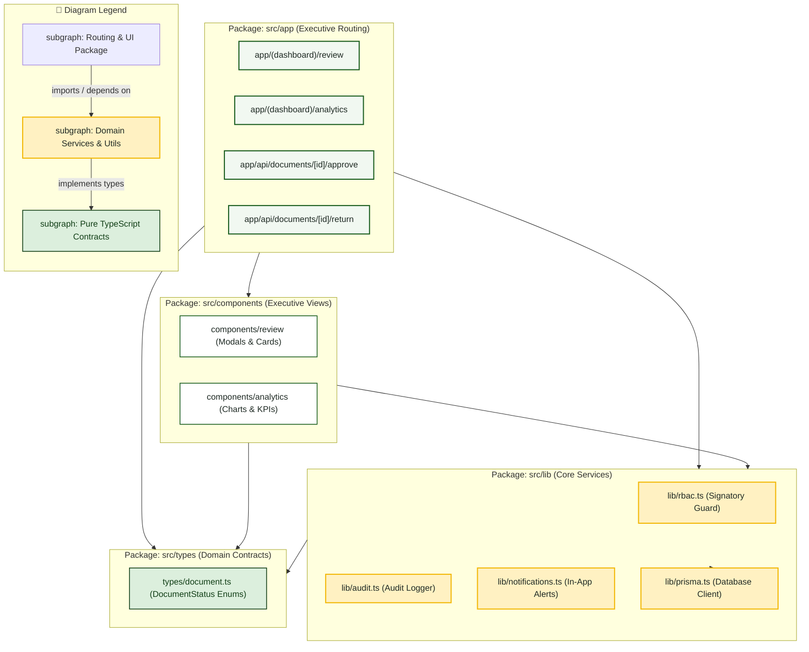
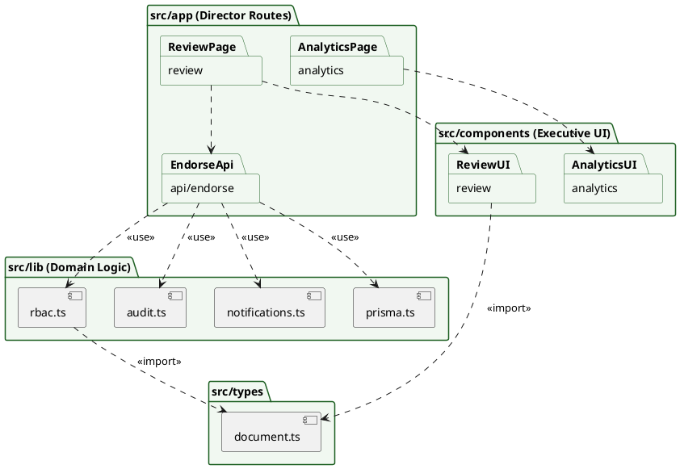

# Campus Director — Package Diagram

> **Role:** `DIRECTOR`  
> **Diagram Type:** Package Diagram  
> **Standard:** UML 2.5 Package Specification

---

## 1. Purpose

The Package Diagram shows the codebase packages, UI modules, and domain services that implement the executive review and analytics subsystem.

---

## 2. Mermaid Package Diagram

---

## 3. Diagram Legend & Symbol Guide

| Visual Symbol | Syntax / Style | UML Package Concept | MinSU DocTrack Codebase Structure |
|---|---|---|---|
| 🟩 Green Folder | `fill:#F1F8F1, stroke:#1B5E20` | Presentation & Routing Package | Next.js App Router (`src/app`) & React components (`src/components`) |
| 🟨 Gold Folder | `fill:#FFF1C2, stroke:#F2B705` | Core Business & Lib Services | Prisma singleton, crypto auth, RBAC guards, PDF compiler (`src/lib`) |
| 🟩 Dark Green Box | `fill:#DCEFDD, stroke:#123F17` | Contract & Persistence Schema | Strictly typed schemas (`src/types`) and ORM definition (`prisma/`) |
| `-->` Solid Arrow | Downward Package Dependency | Upstream module imports or depends on downstream services (strictly unidirectional) |

---

## 4. PlantUML Package Diagram

---

## 5. Package Coupling Rules

- Executive presentation packages (`components/review`, `components/analytics`) depend on data contracts without circular references.
- `EndorseApi` coordinates mutations across RBAC, Audit, and Notification services.
