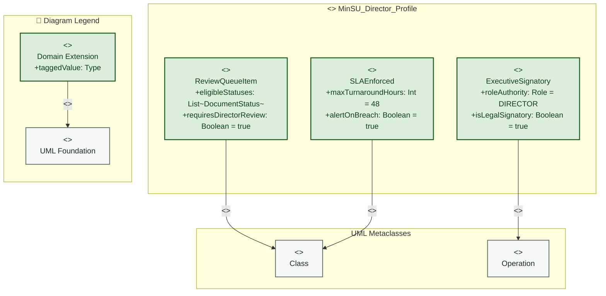

# Campus Director — Profile Diagram

> **Role:** `DIRECTOR`  
> **Diagram Type:** Profile Diagram  
> **Target Domain:** Executive Endorsement & Review Turnaround Governance

---

## 1. Purpose

The Profile Diagram defines domain-specific UML stereotypes and constraints governing the Campus Director's endorsement authority, review queues, and turnaround SLAs.

---

## 2. Mermaid Profile Diagram



---

## 3. Diagram Legend & Symbol Guide

| Visual Symbol | Syntax / Style | UML Profile Mechanism | MinSU Governance Application |
|---|---|---|---|
| `<<metaclass>>` Box | `fill:#F6F8F6, stroke:#55645B` | Core UML base meta-element | Standard UML `Class` or `Component` |
| `<<stereotype>>` Box | `fill:#DCEFDD, stroke:#1B5E20` | Domain-specific extension | `<<TDPAnnex>>`, `<<FinancialAnnex>>`, `<<AuditedEntity>>`, `<<ExecutiveReviewable>>` |
| `+taggedValue: Type` | Tagged Value Attribute | Metadata property attached to stereotype | `annexNumber`, `signatoryRole`, `slaHours = 48`, `requiresDisbursementCheck` |
| `-- "<<extension>>" -->` | Extension Relationship | Extends metaclass semantics | Connects custom TDP stereotype to standard UML metaclass |
| `-- "<<generalization>>" -->` | Specialization Hierarchy | Stereotype inheritance | `FinancialAnnex` inherits all properties of `TDPAnnex` |


---

## 4. PlantUML Profile Diagram

```plantuml
@startuml
skinparam packageBackgroundColor #FFFFFF
skinparam packageBorderColor #1B5E20

package "<<profile>> MinSU_Director_Profile" {
  class "Class" <<metaclass>> as MetaClass
  class "Operation" <<metaclass>> as MetaOp

  class "ExecutiveSignatory" <<stereotype>> {
    + roleAuthority : Role = DIRECTOR
    + isLegalSignatory : Boolean = true
  }

  class "ReviewQueueItem" <<stereotype>> {
    + eligibleStatuses : List<DocumentStatus>
    + requiresDirectorReview : Boolean = true
  }

  class "SLAEnforced" <<stereotype>> {
    + maxTurnaroundHours : Integer = 48
    + alertOnBreach : Boolean = true
  }

  ExecutiveSignatory -up-> MetaOp : "<<extension>>"
  ReviewQueueItem -up-> MetaClass : "<<extension>>"
  SLAEnforced -up-> MetaClass : "<<extension>>"
}
@enduml
```

---

## 5. Stereotype Definitions

| Stereotype | Metaclass | Tagged Values | Purpose |
|---|---|---|---|
| `<<ExecutiveSignatory>>` | `Operation` | `roleAuthority: Role`, `isLegalSignatory: Boolean` | Identifies endpoints that endorse or return university documents. |
| `<<ReviewQueueItem>>` | `Class` | `eligibleStatuses: List`, `requiresDirectorReview: Boolean` | Flags documents that must route to `/review`. |
| `<<SLAEnforced>>` | `Class` | `maxTurnaroundHours: Int`, `alertOnBreach: Boolean` | Enforces the 48-hour executive endorsement velocity window. |
