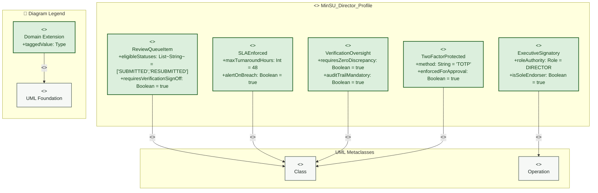

# Campus Director — Profile Diagram

> **Role:** `DIRECTOR`  
> **Diagram Type:** Profile Diagram  
> **Target Domain:** Executive Endorsement, 2FA Protection, and Review Turnaround Governance

---

## 1. Purpose

The Profile Diagram defines domain-specific UML stereotypes and constraints governing the Campus Director's endorsement authority, two-factor authentication gates, verification oversight, and 48-hour review turnaround SLAs.

---

## 2. Mermaid Profile Diagram

---

## 3. Diagram Legend & Symbol Guide

| Visual Symbol | Syntax / Style | UML Profile Mechanism | MinSU Governance Application |
|---|---|---|---|
| `<<metaclass>>` Box | `fill:#F6F8F6, stroke:#55645B` | Core UML base meta-element | Standard UML `Class` or `Operation` |
| `<<stereotype>>` Box | `fill:#DCEFDD, stroke:#1B5E20` | Domain-specific extension | `<<ExecutiveSignatory>>`, `<<SLAEnforced>>`, `<<TwoFactorProtected>>` |
| `+taggedValue: Type` | Tagged Value Attribute | Metadata property attached to stereotype | `maxTurnaroundHours = 48`, `method = 'TOTP'`, `isSoleEndorser = true` |
| `-- "<<extension>>" -->` | Extension Relationship | Extends metaclass semantics | Connects custom director stereotype to standard UML metaclass |

---

## 4. Stereotype Tagged Values & Rules

- **`<<ExecutiveSignatory>>`**: Restricts document endorsement exclusively to authenticated users holding the `CAMPUS_DIRECTOR` role.
- **`<<ReviewQueueItem>>`**: Dictates that only documents in `SUBMITTED` or `RESUBMITTED` states are visible in the director review queue.
- **`<<SLAEnforced>>`**: Establishes a strict 48-hour review turnaround window from initial staff submission.
- **`<<VerificationOversight>>`**: Mandates executive review of tripartite cross-matching stats prior to Annex 4 endorsement.
- **`<<TwoFactorProtected>>`**: Enforces Microsoft Authenticator TOTP verification prior to executing endorsement operations.
