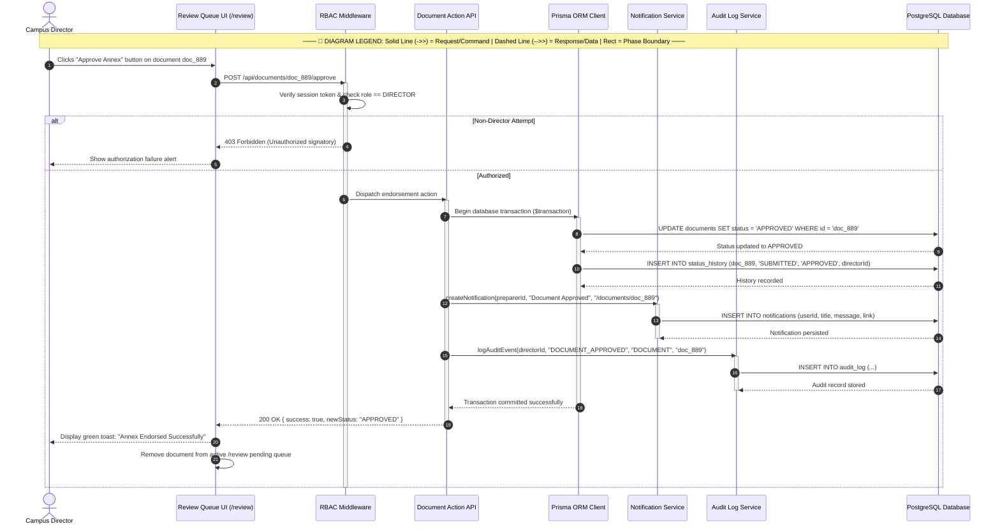

# Campus Director — Sequence Diagram

> **Role:** `DIRECTOR`  
> **Diagram Type:** Sequence Diagram  
> **Scenario:** Document Endorsement & Rejection Message Sequences

---

## 1. Purpose

The Sequence Diagram shows the messages exchanged in chronological order when the Campus Director endorses or returns a submitted Annex document.

---

## 2. Mermaid Sequence Diagram

---

## 3. Diagram Legend & Symbol Guide

| Visual / Symbol | Element Type | Technical Role | MinSU DocTrack Context |
|---|---|---|---|
| 👤 `actor` | Human Actor | External user role triggering system operations | Student Applicant, Staff Coordinator, Campus Director, Accounting Officer |
| 🔲 `participant` | System Component | Internal software subsystem or persistence boundary | Web UI, API Endpoint, Workflow Engine, Prisma/PostgreSQL, PDF Compiler |
| ──▶ `->>` | Solid Arrow | Synchronous invocation or command message | Submitting forms, verifying tokens, invoking database writes |
| - - ▷ `-->>` | Dashed Arrow | Return response or data payload | Confirmation slips, tracking codes, PDF binary buffers, query results |
| 🔲 `activate / deactivate` | Activation Lifeline | Period during which a component executes logic | Active request execution on API controllers or PDF engines |
| 🔲 `alt / else` | Conditional Fragment | Decision tree handling alternative workflow paths | Approval vs. Return branching, SLA compliance checks |

---

## 4. Sequence Details

1. Director triggers endorsement for a pending document.
2. RBAC Guard verifies that the authenticated user possesses the `DIRECTOR` role.
3. API executes an atomic PostgreSQL transaction:
   - Updates document status to `APPROVED`.
   - Records the state transition in `status_history`.
   - Generates an in-app notification for the preparer (`STAFF` or `ACCOUNTING`).
   - Writes an immutable audit entry documenting the endorsement.
4. Transaction commits, and the UI removes the item from the pending list.
