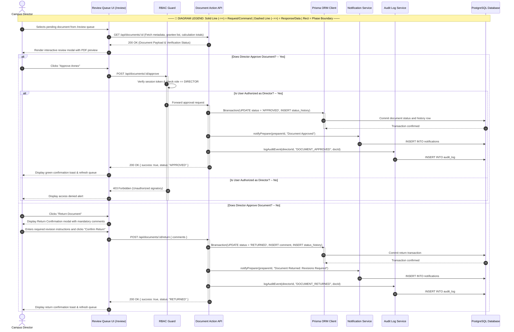

# Campus Director — Sequence Diagram

> **Role:** `DIRECTOR`  
> **Diagram Type:** Sequence Diagram  
> **Scenario:** Executive Review, Endorsement, and Return Decisions  
> **Standard:** UML 2.5 Sequence Specification

---

## 1. Purpose

The Sequence Diagram shows the messages exchanged in chronological order when the Campus Director reviews, approves, or returns a submitted Annex document. All conditional decisions evaluate strictly to binary Yes and No paths.

---

## 2. Mermaid Sequence Diagram

---

## 3. Diagram Legend & Symbol Guide

| Visual / Symbol | Element Type | Technical Role | MinSU DocTrack Context |
|---|---|---|---|
| `Actor` | Human User | Initiator of operational procedures | Campus Director executing executive reviews |
| `Participant` | System Component | Boundary, controller, or data store | Review UI, RBAC Guard, Prisma Client, PostgreSQL |
| `->>` | Synchronous Message | Command or method invocation | Approve document, verify token, notify author |
| `-->>` | Return Message | Response data or confirmation payload | Status payload, HTTP 200 OK confirmation |
| `alt / else` | Conditional Frame | Guarded execution path (**Yes** / **No**) | Does Director Approve? Yes -> Approve; No -> Return |

---

## 4. Execution Sequence Steps

1. Director navigates to `/review` and selects a pending document.
2. System displays structured tables, fiscal math totals, and 3-way verification badges.
3. If Director approves (**Yes**), system verifies authorization, marks document `APPROVED`, and alerts the preparer.
4. If Director returns (**No**), system prompts for required comments, marks document `RETURNED`, and unlocks the form for corrections.
