# Campus Director — State Machine Diagram

> **Role:** `DIRECTOR` (Signatory Lifecycle Authority)  
> **Diagram Type:** State Machine Diagram  
> **Entity:** `Document` & Verification Oversight Lifecycle  
> **Standard:** UML 2.5 State Machine Specification

---

## 1. Purpose

The State Machine Diagram shows the lifecycle states of a TDP Annex document during executive review and verification oversight. All decision choices evaluate strictly to binary Yes and No paths.

---

## 2. Mermaid State Machine Diagram

```mermaid
stateDiagram-v2
    direction TB

    [*] --> DRAFT : Preparer drafts document

    DRAFT --> SUBMITTED : submitForReview() [all required fields valid]

    state evaluate_queue <<choice>>
    SUBMITTED --> evaluate_queue : Director reviews document payload

    state check_verification <<choice>>
    evaluate_queue --> check_verification : [Does Director Approve Document? -- Yes]
    evaluate_queue --> RETURNED : [Does Director Approve Document? -- No]

    check_verification --> APPROVED : [Zero Unresolved Discrepancies? -- Yes]
    check_verification --> RETURNED : [Zero Unresolved Discrepancies? -- No]

    state RETURNED {
        [*] --> CommentsAttached : Mandatory feedback recorded
        CommentsAttached --> UnlockedForCorrection : Preparer edits data
    }

    UnlockedForCorrection --> RESUBMITTED : resubmitForReview()
    RESUBMITTED --> evaluate_queue

    state APPROVED {
        [*] --> LockedAgainstEdit : Roster and figures locked
        LockedAgainstEdit --> ReadyForExcelExport : Multi-tab Excel generation enabled
    }

    ReadyForExcelExport --> UPLOADED : uploadSignedScan() [physical wet-signatures applied]
    UPLOADED --> TRANSMITTED : recordTransmittal() [dispatched to CHED]
    TRANSMITTED --> ARCHIVED : archiveDocument() [semester finalized]
    ARCHIVED --> [*]

    %% ─── 📌 VISUAL LEGEND ───
    note right of evaluate_queue
        <b>📌 DIAGRAM LEGEND</b>
        ● [*] : Initial / Terminal Boundary
        [StateName] : Active Lifecycle Status
        <<choice>> : Mutually Exclusive Decision Point
        --> : Trigger Event Transition
        [guard] : Guard Rule (Strictly Yes / No)
    end note
```

---

## 3. Diagram Legend & Symbol Guide

| Visual Symbol / Syntax | UML State Machine Concept | Technical Meaning | MinSU Document & Student Lifecycle |
|---|---|---|---|
| `● [*]` | Initial State Node | Point of entry into a lifecycle region | Document creation initiated by staff or accounting |
| `◎ [*]` | Terminal State Node | Final conclusion of lifecycle | Document permanently archived following transmittal |
| `state "Name"` | Composite State | Container holding nested sub-states | `RETURNED` (holds `CommentsAttached`), `APPROVED` (holds `LockedAgainstEdit`) |
| `<<choice>>` | Decision Pseudostate | Dynamic evaluation of runtime guard | Decision gate evaluating strictly to **Yes** or **No** |
| `-->` | Transition Arrow | Movement from one state to another | Submit, evaluate, endorse, transmit |
| `[guard]` | Transition Guard | Boolean condition that must evaluate to TRUE | `[Does Director Approve? -- Yes]`, `[Zero Discrepancies? -- Yes]` |

---

## 4. State Details & Behavioral Constraints

- **`SUBMITTED`**: Document is locked against preparer edits and enters the director review queue.
- **`evaluate_queue` Choice**: Director determines whether compliance and financial figures meet policy (**Yes** / **No**).
- **`check_verification` Choice**: If approving, system verifies that all associated student grantees have zero unresolved discrepancies (**Yes** / **No**).
- **`APPROVED`**: Locks masterlist and authorizes native multi-tab `ExcelJS` streaming.
- **`RETURNED`**: Attaches mandatory director comments and unlocks the form for corrections.
- **`TRANSMITTED`**: Indicates physical hardcopy dispatch to CHED MMARO with courier tracking and Google Drive verification link.
