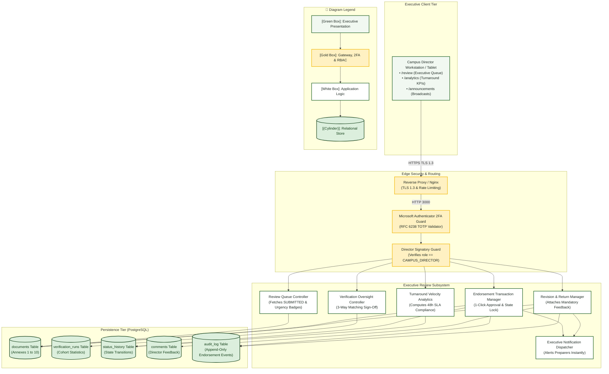

# Campus Director — System Architecture Diagram

> **Role:** `DIRECTOR`  
> **Diagram Type:** System Architecture Diagram  
> **Focus:** Executive Review Subsystem, Analytics Engine, 2FA Gate & Verification Oversight

---

## 1. Purpose

The System Architecture Diagram shows the multi-tier architecture used by the Campus Director, including client presentation, edge security with 2FA verification, endorsement transaction controllers, and PostgreSQL persistence.

---

## 2. Mermaid System Architecture Diagram

---

## 3. Diagram Legend & Symbol Guide

| Visual Symbol | Syntax / Style | Tier Concept | MinSU Implementation |
|---|---|---|---|
| Client Tier | `#F1F8F1` Box | User Workstation Presentation | Next.js browser views for executive review |
| Edge Tier | `#FFF1C2` Box | Gateway, 2FA & Authorization | Reverse proxy, TOTP validator, `DirectorRBAC` |
| Application Tier | `#FFFFFF` Box | Domain Services | Endorsement manager, verification oversight, analytics |
| Persistence Tier | Cylinder Shape | Relational Storage | PostgreSQL database (`documents`, `verification_runs`) |

---

## 4. Tier Responsibilities

- **Client Tier**: Renders the director review queue, responsive PDF document previews, and SLA compliance gauges.
- **Edge Tier**: Validates Microsoft Authenticator TOTP session tokens and blocks non-director users with HTTP 403 Forbidden.
- **Application Tier**: Executes atomic approval transactions, calculates average turnaround duration, and triggers real-time alerts.
- **Persistence Tier**: Records immutable timestamps on `status_history` and `audit_log` tables for audit defense.
