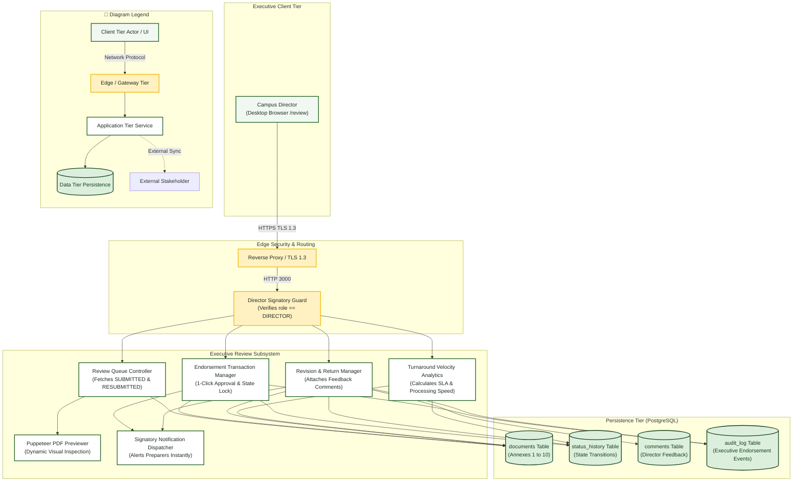

# Campus Director — System Architecture Diagram

> **Role:** `DIRECTOR`  
> **Diagram Type:** System Architecture Diagram  
> **Focus:** Executive Review Subsystem, Analytics Engine & Endorsement Boundaries

---

## 1. Purpose

The System Architecture Diagram shows the components of the executive review subsystem used by the Campus Director. It illustrates the Director browser, review queue cache, endorsement transactions, and analytics engine.

---

## 2. Mermaid System Architecture Diagram

---

## 3. Diagram Legend & Symbol Guide

| Visual Symbol | Syntax / Style | Architectural Tier | MinSU System Implementation |
|---|---|---|---|
| 🟩 Soft Green Box | `fill:#F1F8F1, stroke:#1B5E20` | Client Presentation Tier | Browser clients for Student, Staff, Director, Accounting, and Admin |
| 🟨 Gold Box | `fill:#FFF1C2, stroke:#F2B705` | Edge & Security Gateway Tier | Nginx TLS termination reverse-proxy and Next.js edge RBAC middleware |
| ⬜ White Box | `fill:#FFFFFF, stroke:#1B5E20` | Core Application Tier | Next.js Server Components, Document Engine, Auth Controller, PDF Compiler |
| 🟩 Dark Green Cylinder | `fill:#DCEFDD, stroke:#123F17` | Persistent Data Tier | PostgreSQL 16 relational database (Port 5432) and local storage volumes |
| ◻️ Dashed Border Box | `stroke-dasharray: 5 5` | External Stakeholder / Boundary | CHED/UniFAST regional office and external Google Drive transmittal archive |
| `-->` Solid Arrow | Network & Internal Call | Synchronous HTTPS, WSS, HTTP (port 3000), or TCP (port 5432) |
| `-.->` Dashed Arrow | Out-of-Band Integration | Physical courier shipment or external cloud drive URL synchronization |

---

## 4. Architecture Rules

- The `Director Signatory Guard` rejects any approval or return requests from non-director roles.
- `Endorsement Transaction Manager` updates document status and logs status history atomically.
- `Velocity Analytics` computes turnaround metrics using timestamps from `status_history`.
