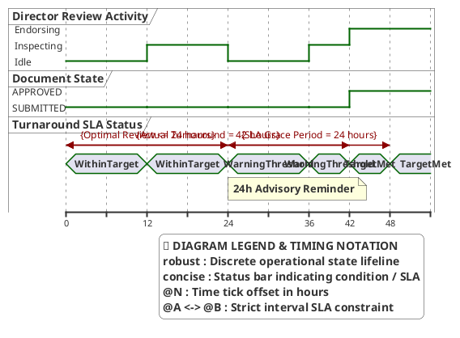

# Campus Director — Timing Diagram

> **Role:** `DIRECTOR`  
> **Diagram Type:** Timing Diagram  
> **Scenario:** Executive Review Turnaround SLA & Escalation Thresholds  
> **Standard:** UML 2.5 Timing Specification

---

## 1. Purpose

The Timing Diagram shows the lifecycle states of documents in the review queue and the strict 48-hour executive endorsement SLA.

---

## 2. PlantUML Timing Diagram

---

## 3. Diagram Legend & Symbol Guide

| Notation / Element | Type / Syntax | Temporal Role | MinSU Operational Application |
|---|---|---|---|
| `robust "Lifeline"` | Discrete State Lifeline | Tracks operational state transitions over time | `DirAct` (Director Review Activity), `DocState` (Submitted vs. Approved) |
| `concise "Status"` | Status Interval Bar | Tracks SLA compliance threshold | `SLAState` (`WithinTarget`, `WarningThreshold`, `TargetMet`) |
| `@N` | Time Tick Offset | Elapsed hour marker from document submission | `@0` (Queue entry), `@24` (24h advisory warning), `@42` (Approved), `@48` (SLA limit) |
| `@A <-> @B : {Rule}` | Time Constraint Interval | Hard institutional deadline or turnaround window | Optimal Review (<= 24h), Grace Period (24h), Total SLA (48h) |
| `note bottom of ...` | Event Milestone Callout | Operational trigger annotation | 24h advisory reminder, approval timestamp within 48h SLA |

---

## 4. Timeline & SLA Constraints

| Timestamp | Document State | SLA Window | Description |
|---|---|---|---|
| `0 hours` | `SUBMITTED` | `WithinTarget` | Document lands in Director review queue. |
| `24 hours` | `SUBMITTED` | `WarningThreshold` | System issues a 24-hour reminder alert if unreviewed. |
| `42 hours` | `APPROVED` | `TargetMet` | Director completes endorsement before 48-hour breach. |
| `> 48 hours` | Unreviewed | `Breached` | Triggers executive escalation flag in analytics dashboard. |
