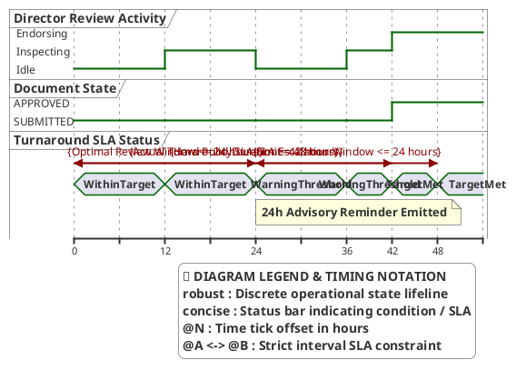

# Campus Director — Timing Diagram

> **Role:** `DIRECTOR`  
> **Diagram Type:** Timing Diagram  
> **Scenario:** Executive Review Turnaround SLA & Escalation Thresholds  
> **Standard:** UML 2.5 Timing Specification

---

## 1. Purpose

The Timing Diagram shows the lifecycle states of documents in the executive review queue and the strict 48-hour endorsement SLA monitored by the Campus Director.

---

## 2. PlantUML Timing Diagram

---

## 3. Diagram Legend & Symbol Guide

| Visual Symbol | Syntax / Style | UML Timing Concept | MinSU Implementation Context |
|---|---|---|---|
| Lifeline Wave | `robust "Name"` | Continuous state value of an entity | Director Activity, Document Status |
| State Label | `Lifeline is STATE` | Active discrete status during interval | `IDLE`, `INSPECTING`, `SUBMITTED`, `APPROVED` |
| SLA State Bar | `concise "Name"` | Qualitative operational condition | `WithinTarget`, `WarningThreshold`, `TargetMet` |
| Time Constraint | `@A <-> @B : {Label}` | Enforced operational deadline (SLA) | 48-hour maximum director review limit |

---

## 4. Timeline Milestones & Turnaround Constraints

- **Hour 0**: Document transitions to `SUBMITTED`; SLA countdown begins on the Director dashboard.
- **Hour 24**: System emits an amber warning badge if the document remains unreviewed.
- **Hour 42**: Director inspects grantee rosters, verifies zero discrepancies, and clicks "Approve Annex".
- **Hour 48**: Hard policy SLA ceiling; any document unreviewed at 48 hours is flagged as overdue in `/analytics`.
