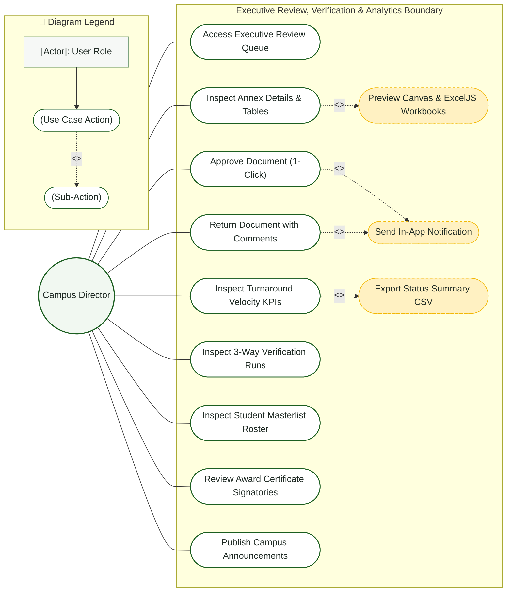
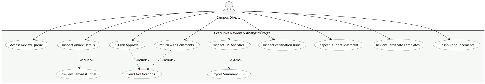

# Campus Director — Use Case Diagram

> **Role:** `DIRECTOR`  
> **Diagram Type:** Use Case Diagram  
> **Standard:** UML 2.5 Use Case Specification

---

## 1. Purpose

The Use Case Diagram shows what the Campus Director does in MinSU DocTrack. It defines executive document endorsement, return actions, analytics monitoring, 3-way verification oversight, and campus announcements.

---

## 2. Mermaid Use Case Diagram

---

## 3. Diagram Legend & Symbol Guide

| Visual Symbol | Syntax / Style | UML Use Case Concept | MinSU System Implementation |
|---|---|---|---|
| `actor` / `[Actor]` | External Role | Executive signing authority | Campus Director |
| `usecase` / `(["(Action)"])` | Use Case Unit | Executive goal or inspection capability | 1-Click Approve, Return with Notes, Inspect Verification, KPI Analytics |
| `-->` Solid Arrow | Actor Association | User initiates action | Director approves document, reviews runs, publishes announcements |
| `..>` / `-.->` Dashed Arrow | Stereotyped Dependency | Relationship between use cases | `<<include>>` (Mandatory preview or alert) or `<<extend>>` (Optional CSV export) |

---

## 4. PlantUML Use Case Diagram

