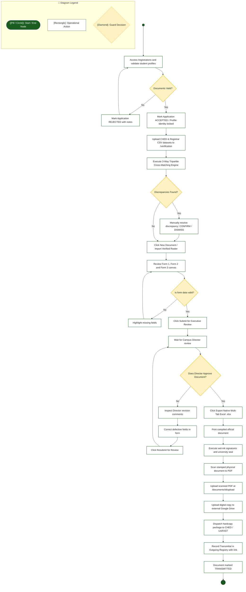
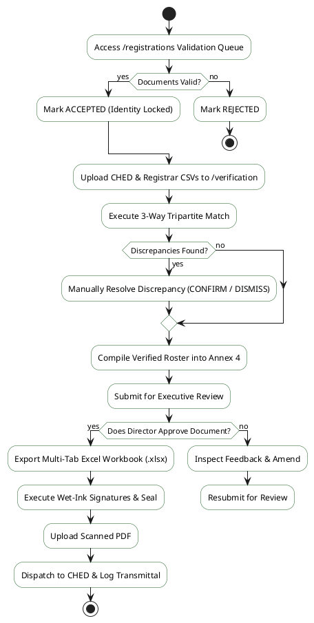

# Staff Coordinator — Activity Diagram

> **Role:** `STAFF`  
> **Diagram Type:** Activity Diagram  
> **Workflow:** Registration Validation, 3-Way Tripartite Verification, Annex Preparation, Endorsement & Transmittal

---

## 1. Purpose

The Activity Diagram shows the full operational sequence executed by the Staff Coordinator, from validating student intake applications and running 3-way tripartite verification to drafting Annexes, exporting multi-tab Excel workbooks, and logging agency transmittals.

---

## 2. Mermaid Activity Diagram

---

## 3. Diagram Legend & Symbol Guide

| Visual Symbol | Syntax / Style | UML Activity Concept | MinSU System Implementation |
|---|---|---|---|
| `Start / End` | `(( ))` / `((( )))` | Initial / Final State | Process starts at registration validation and ends at transmittal archival |
| `Action` | `[Rectangle]` | Operational Procedure | Validate Queue, Run 3-Way Match, Compile Annex, Export Excel, Scan Upload |
| `Decision` | `{Diamond}` | Guard Evaluation | Documents Valid?, Discrepancies Found?, Review Outcome? |

---

## 4. PlantUML Activity Diagram

