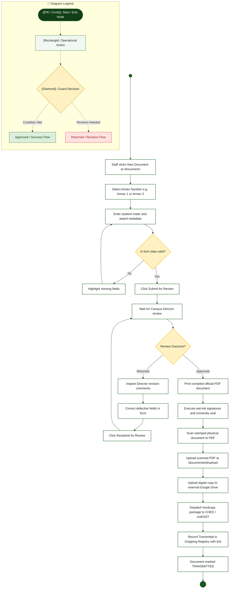

# Staff Coordinator — Activity Diagram

> **Role:** `STAFF`  
> **Diagram Type:** Activity Diagram  
> **Workflow:** Annex Preparation, Endorsement, Physical Scan Upload & Transmittal

---

## 1. Purpose

The Activity Diagram shows the full lifecycle sequence executed by the Staff Coordinator, from drafting an Annex document to logging its final transmittal to CHED.

---

## 2. Mermaid Activity Diagram

---

## 3. Diagram Legend & Symbol Guide

| Visual Symbol | Syntax / Node Type | Technical Role | MinSU Domain Meaning |
|---|---|---|---|
| `([Pill / Circle])` | `([Start / End])` / `(( ))` | Initial or terminal workflow boundary | Workflow entry point, queue initiation, terminal archive closure |
| `[Rectangle]` | `["Action"]` | Operational task or software routine | Inspecting forms, computing sums, generating receipt, updating status |
| `{Diamond}` | `{"Decision"}` | Mutually exclusive condition / guard | "Compliance verified?", "Variance == 0.00?", "Quota available?" |
| `──▶` | Solid Line `-->` | Sequential flow transition | Standard forward progression between operational activities |
| `-->|Label|` | Guarded Branch | Conditional execution path | "Yes / Approved", "No / Return with Remarks" |
| 🔲 Subgraph | `subgraph Lane` | Departmental Swimlane Boundary | Segregates duties across roles and authority boundaries |
| 🟢 Green Tone | `#DCEFDD` / `#1B5E20` | Approved State / Forward Flow | Validated submissions, executive approvals, zero-variance checks |
| 🟡 Gold Tone | `#FFF1C2` / `#B88A00` | Evaluation / Inspection Gate | Review queues, quota verification, decision checkpoints |
| 🔴 Red / Rose Tone | `#FEE2E2` / `#DC2626` | Return / Discrepancy Alert | Ineligible applications, returned documents, ledger adjustments |

---

## 4. Workflow Steps

1. Staff initiates a new document form at `/documents`.
2. Staff populates dynamic tabular fields with verified student data.
3. System verifies schema compliance and transitions status to `SUBMITTED`.
4. If Director returns the document, Staff corrects errors and resubmits.
5. Upon approval, Staff prints the system-generated PDF.
6. University signatories sign the document and apply the official seal.
7. Staff scans the signed hardcopy and uploads the PDF to DocTrack.
8. Staff uploads a duplicate to Google Drive and delivers the physical transmittal.
9. Staff logs the transmittal record with courier info and URL in the Outgoing Registry.
