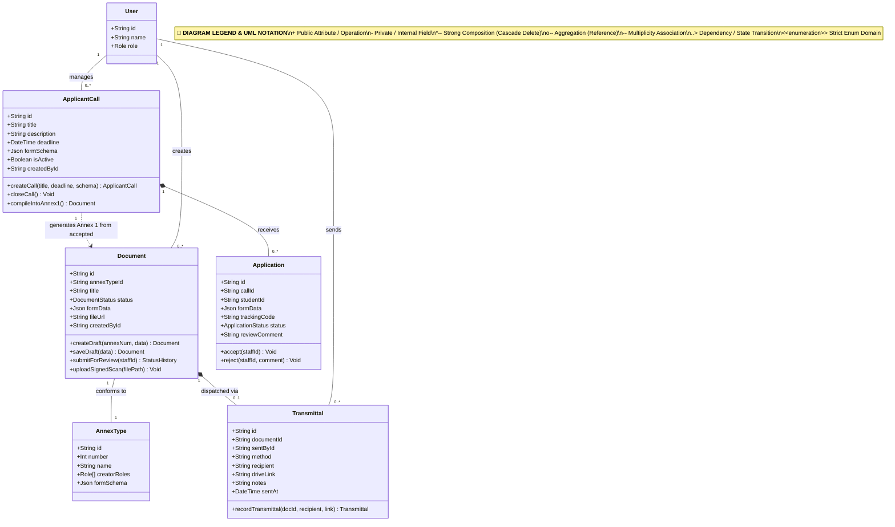

# Staff Coordinator — Class Diagram

> **Role:** `STAFF`  
> **Diagram Type:** Class Diagram  
> **Standard:** UML 2.5 Class Specification

---

## 1. Purpose

The Class Diagram shows the domain models, attributes, operations, and relationships governing Staff operations, including document preparation, call management, and transmittal logging.

---

## 2. Mermaid Class Diagram

---

## 3. Diagram Legend & Symbol Guide

| Symbol / UML Notation | Meaning & Syntax | Technical Function | MinSU Domain Example |
|---|---|---|---|
| `+` | Public Visibility | Readable attribute or callable method | `+id`, `+title`, `+submitDocument()`, `+validateZeroVariance()` |
| `-` | Private Visibility | Encapsulated field | Password hashes, system flags, sensitive session tokens |
| `<<enumeration>>` | Enum Classifier | Strict closed set of categorical values | `Role` (`DIRECTOR`, `STAFF`), `DocumentStatus` (`APPROVED`, `SUBMITTED`) |
| `*--` | Strong Composition | Lifecycle containment (child deleted on parent deletion) | `Document *-- StatusHistory`, `Document *-- Comment` |
| `o--` | Weak Aggregation | Referenced association without ownership | `Document o-- User` (Document references author) |
| `--` | Association (`"1" -- "*"`) | Multiplicity mapping between database entities | One user creates many documents or receives notifications |
| `..>` | Dependency | Usage or transition relationship | Domain model transitioning document lifecycle states |

---

## 4. Operations & Domain Rules

- `createDraft()` instantiates an Annex form according to the `formSchema` in `AnnexType`.
- `compileIntoAnnex1()` aggregates accepted student records into a tabular Annex 1 draft.
- `uploadSignedScan()` sets `fileUrl` and changes status to `UPLOADED`.
- `recordTransmittal()` creates a `Transmittal` record and marks the document `TRANSMITTED`.
