# Staff Coordinator — Class Diagram

> **Role:** `STAFF`  
> **Diagram Type:** Class Diagram  
> **Standard:** UML 2.5 Class Specification

---

## 1. Purpose

The Class Diagram shows the domain models, attributes, operations, and relationships for the Staff Coordinator role. It shows document preparation, student intake validation, 3-way tripartite verification, certificate customization, and transmittal logging.

---

## 2. Mermaid Class Diagram

```mermaid
classDiagram
    direction TB

    class Role {
        <<enumeration>>
        STAFF
        STUDENT
        DIRECTOR
        ACCOUNTING
        SYSTEM_ADMIN
    }

    class DocumentStatus {
        <<enumeration>>
        DRAFT
        SUBMITTED
        APPROVED
        RETURNED
        SENT_TO_AGENCY
        ARCHIVED
    }

    class VerificationStatus {
        <<enumeration>>
        FULLY_VERIFIED
        NEEDS_ENCODING
        NOT_ENROLLED
        SYSTEM_DISCREPANCY
        POSSIBLE_MATCH
        ENROLLED_NON_SCHOLAR
    }

    class Document {
        +String id
        +String annexTypeId
        +String title
        +DocumentStatus status
        +Json formData
        +String fileUrl
        +String createdById
        +createDraft(annexNum, data) Document
        +saveDraft(data) Document
        +submitForReview(staffId) StatusHistory
        +uploadSignedScan(filePath) Void
        +exportExcel() Buffer
    }

    class AnnexType {
        +String id
        +Int number
        +String name
        +Role[] creatorRoles
        +Json formSchema
    }

    class ApplicantCall {
        +String id
        +String title
        +String description
        +DateTime deadline
        +Json formSchema
        +Boolean isActive
        +String createdById
        +createCall(title, deadline, schema) ApplicantCall
        +closeCall() Void
        +compileIntoAnnex1() Document
    }

    class Application {
        +String id
        +String callId
        +String studentId
        +Json formData
        +String trackingCode
        +ApplicationStatus status
        +String reviewComment
        +Boolean identityLocked
        +accept(staffId) Void
        +reject(staffId, comment) Void
    }

    class VerificationRun {
        +String id
        +String executedById
        +DateTime runDate
        +Int totalChed
        +Int totalRegistrar
        +Int totalSystem
        +Int matchedCount
        +Int discrepancyCount
        +executeMatch(chedCsv, regCsv) VerificationRun
        +exportDiscrepanciesExcel() Buffer
    }

    class VerificationResult {
        +String id
        +String runId
        +String studentId
        +String studentName
        +VerificationStatus status
        +Json discrepancyDetails
        +Boolean resolved
        +String resolutionNotes
        +resolveDiscrepancy(action, notes) Void
    }

    class CertificateTemplate {
        +String id
        +String campusId
        +String paperSize
        +String orientation
        +Json signatories
        +String citationBody
        +saveTemplate(layoutData) CertificateTemplate
        +exportWordDocument(studentId) Buffer
    }

    class Transmittal {
        +String id
        +String documentId
        +String sentById
        +String method
        +String recipient
        +String driveLink
        +String notes
        +DateTime sentAt
        +recordTransmittal(docId, recipient, link) Transmittal
    }

    class Announcement {
        +String id
        +String title
        +String content
        +String audience
        +Boolean pinned
        +String authorId
        +createAnnouncement(title, body, target) Announcement
    }

    class User {
        +String id
        +String name
        +String email
        +Role role
        +Boolean twoFactorEnabled
    }

    Document "1" -- "1" AnnexType : conforms to
    Document "1" *-- "0..1" Transmittal : dispatched via
    ApplicantCall "1" *-- "0..*" Application : receives
    ApplicantCall "1" ..> Document : generates Annex 1 from accepted
    VerificationRun "1" *-- "0..*" VerificationResult : produces
    VerificationRun ..> Document : syncs verified roster into Annex 4
    CertificateTemplate ..> Document : formats Annex 10 awards
    User "1" -- "0..*" Document : creates
    User "1" -- "0..*" ApplicantCall : manages
    User "1" -- "0..*" VerificationRun : executes
    User "1" -- "0..*" Transmittal : sends
    User "1" -- "0..*" Announcement : publishes
    User ..> Role : assigned

    %% ─── 📌 VISUAL LEGEND ───
    note "<b>📌 DIAGRAM LEGEND & UML NOTATION</b>\n+ Public Attribute / Operation\n- Private / Internal Field\n*-- Strong Composition (Cascade Delete)\no-- Aggregation (Reference)\n-- Multiplicity Association\n..> Dependency / State Transition\n&lt;&lt;enumeration&gt;&gt; Strict Enum Domain"
```

---

## 3. Diagram Legend & Symbol Guide

| Symbol / UML Notation | Meaning & Syntax | Technical Function | MinSU Domain Example |
|---|---|---|---|
| `+` | Public Visibility | Readable attribute or callable method | `+id`, `+executeMatch()`, `+exportExcel()`, `+resolveDiscrepancy()` |
| `-` | Private Visibility | Encapsulated field | Password hashes, cryptographic keys, internal flags |
| `<<enumeration>>` | Enum Classifier | Strict closed set of categorical values | `Role` (`STAFF`), `DocumentStatus` (`APPROVED`), `VerificationStatus` |
| `*--` | Strong Composition | Lifecycle containment (child deleted on parent deletion) | `VerificationRun *-- VerificationResult`, `ApplicantCall *-- Application` |
| `o--` | Weak Aggregation | Referenced association without ownership | `Document o-- User` (Document references creator) |
| `--` | Association (`"1" -- "*"`) | Multiplicity mapping between database entities | One staff user executes many verification runs |
| `..>` | Dependency | Usage or transition relationship | `VerificationRun ..> Document` (Syncs verified grantees into billing) |

---

## 4. Operations & Domain Rules

- `createDraft()` instantiates an Annex form according to the `formSchema` in `AnnexType`.
- `accept()` in `Application` locks the student institutional identity permanently under RA 10173.
- `executeMatch()` executes tripartite cross-matching across CHED, Registrar, and System datasets.
- `resolveDiscrepancy()` sets `resolved` to true with mandatory staff coordinator audit notes.
- `saveTemplate()` persists paper layout dimensions, margins, and custom signatories in `CertificateTemplate`.
- `recordTransmittal()` catalogs courier metadata and external Google Drive links.
