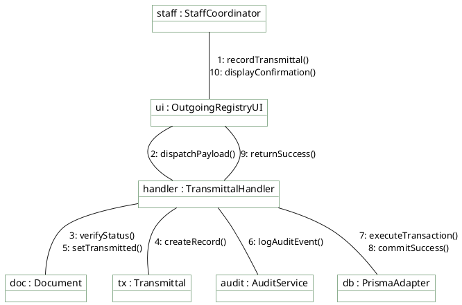

# Staff Coordinator — Communication Diagram

> **Role:** `STAFF`  
> **Diagram Type:** Communication Diagram  
> **Scenario:** Outgoing Transmittal Registration & Registry Synchronization  
> **Standard:** UML 2.5 Communication Specification

---

## 1. Purpose

The Communication Diagram shows which objects interact during transmittal registration. It focuses on the structural links and uses numbered messages to show order.

---

## 2. Mermaid Communication Diagram

```mermaid
flowchart LR
    %% Styling Classes
    classDef actorStyle fill:#F1F8F1,stroke:#1B5E20,stroke-width:2px,color:#1F2A24;
    classDef objStyle fill:#FFFFFF,stroke:#1B5E20,stroke-width:1.5px,color:#1F2A24;

    StaffUser["staff : StaffCoordinator"]:::actorStyle
    RegistryUI["registryUI : OutgoingView"]:::objStyle
    Controller["controller : TransmittalController"]:::objStyle
    DocObj["targetDoc : Document"]:::objStyle
    RecordObj["record : Transmittal"]:::objStyle
    AuditObj["audit : AuditService"]:::objStyle
    DBAdapter["db : PrismaClient"]:::objStyle

    %% Object Links and Numbered Messages
    StaffUser ---|1: recordTransmittal(docId, gdriveLink)| RegistryUI
    RegistryUI ---|2: POST /api/documents/docId/transmit| Controller
    Controller ---|3: verifyStatusIsUploaded(docId)| DocObj
    Controller ---|4: instantiate(docId, method, gdriveLink)| RecordObj
    Controller ---|5: updateStatus(TRANSMITTED)| DocObj
    Controller ---|6: writeAuditLog(TRANSMITTAL_LOGGED)| AuditObj
    Controller ---|7: executeAtomicCommit()| DBAdapter
    DBAdapter ---|8: confirmWriteSuccess()| Controller
    Controller ---|9: 200 OK (Transmittal Registered)| RegistryUI
    RegistryUI ---|10: showSuccessToast()| StaffUser

    %% ─── 📌 VISUAL LEGEND ───
    subgraph Legend ["📌 Diagram Legend"]
        direction TB
        L_Node["Node : Subsystem Component"]:::legNode
        L_Msg["Link: N: methodName(args)"]:::legMsg
        L_Node -->|Call Sequence| L_Msg
    end
    classDef legNode fill:#F1F8F1,stroke:#1B5E20,color:#1F2A24;
    classDef legMsg fill:#FFF1C2,stroke:#B88A00,color:#1F2A24;
```

---

## 3. Diagram Legend & Symbol Guide

| Element | Format / Syntax | Technical Meaning | MinSU Implementation Context |
|---|---|---|---|
| Subsystem Node | `[N: name : Class]` | Structural software participant | Controllers, Workflow Engines, Prisma Client, Storage Adapters |
| Link Connector | `-- "..." -->` | Directed communication channel | HTTP request, RPC method call, or database query |
| Numbered Prefix | `1:`, `2:`, `10:` | Chronological message sequence number | Sequential execution order from client event to persistence and UI update |
| Method Signature | `methodName(params)` | Invoked operation contract | `verifyRole(token)`, `checkVariance()`, `writeAuditLog()` |
| 🟢 Green Tone | `#F1F8F1` / `#1B5E20` | Core Subsystem Component | Institutional controllers, persistence adapters, and business engines |
| 🟡 Gold Tone | `#FFF1C2` / `#B88A00` | Guard & Dispatch Relay | Access guards, validation checks, and notification dispatchers |


---

## 4. PlantUML Communication Diagram



---

## 5. Numbered Message Sequence

1. `Staff` initiates transmittal logging in the UI with a courier tracking ID and Google Drive link.
2. `UI` transmits the payload to `TransmittalHandler`.
3. `Handler` verifies that the document is already in `UPLOADED` status.
4. `Handler` builds the `Transmittal` object.
5. `Handler` transitions document status to `TRANSMITTED`.
6. `Handler` dispatches the audit event.
7. `Handler` executes an atomic database commit through `PrismaAdapter`.
8. `PrismaAdapter` confirms transaction completion.
9. `Handler` returns a 200 HTTP status response.
10. `UI` displays a success toast and appends the record to the Outgoing Registry.
