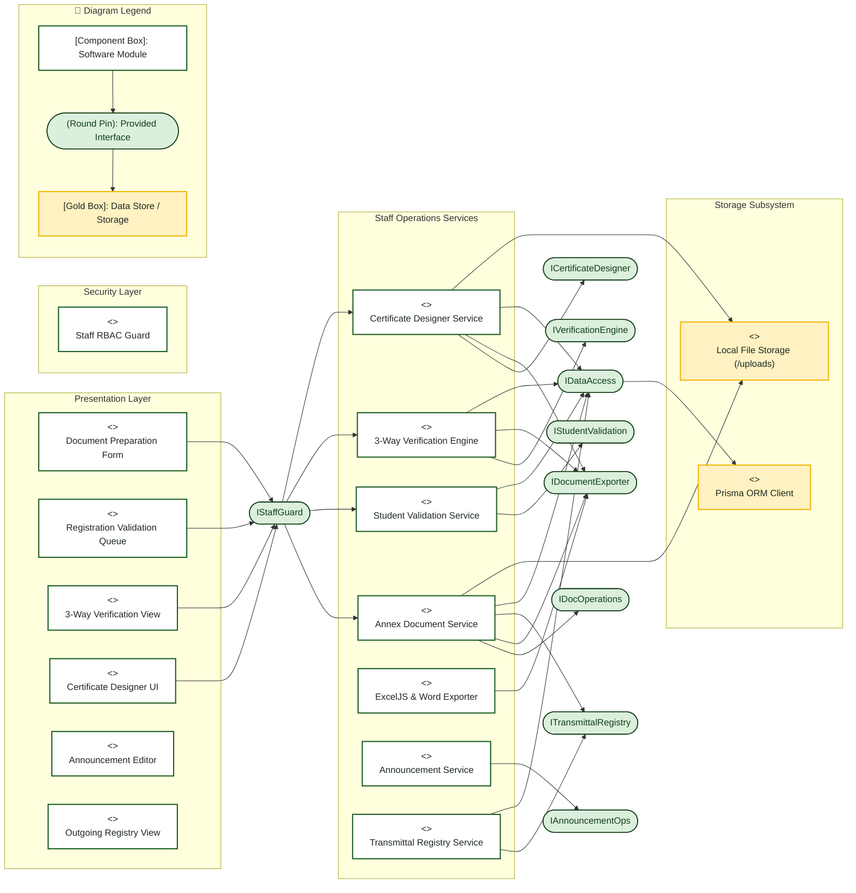

# Staff Coordinator — Component Diagram

> **Role:** `STAFF`  
> **Diagram Type:** Component Diagram  
> **Standard:** UML 2.5 Component Specification

---

## 1. Purpose

The Component Diagram shows the software components, provided interfaces, and required dependencies within the Staff Coordinator operational subsystem.

---

## 2. Mermaid Component Diagram

---

## 3. Diagram Legend & Symbol Guide

| Visual Symbol | Syntax / Style | UML Component Meaning | MinSU Implementation |
|---|---|---|---|
| `[Component]` | `["<<component>>\nName"]` | Autonomous modular unit with internal logic | Document Service, Verification Engine, Certificate Designer |
| `(Interface)` | `(["IName"])` | Formal contract or API boundary | `IVerificationEngine`, `IDocumentExporter`, `IStudentValidation` |
| `Solid Arrow` | `-->` | Direct dependency or communication invocation | UI invokes services through validated interfaces |
| `Data Component` | Gold Tone `#FFF1C2` | Persistence or storage component | Prisma ORM client and local file system storage |

---

## 4. Component Responsibilities

- **Document Preparation Form (`DocUI`)**: Collects Annex 1-5 and 10 dynamic form inputs with real-time field validation.
- **Registration Validation Queue (`QueueUI`)**: Displays submitted student registrations for batch `ACCEPT` or `REJECT` processing.
- **3-Way Verification Engine (`VerifyService`)**: Ingests CHED and Registrar CSV datasets, executes fuzzy cross-matching, and tracks discrepancy resolution.
- **Certificate Designer Service (`CertService`)**: Allows Staff to design award templates, configure signatories, and generate Word (`.doc`) outputs.
- **ExcelJS & Word Exporter (`ExportService`)**: Compiles validated grantee rosters into multi-tab `.xlsx` workbooks and official letters.
