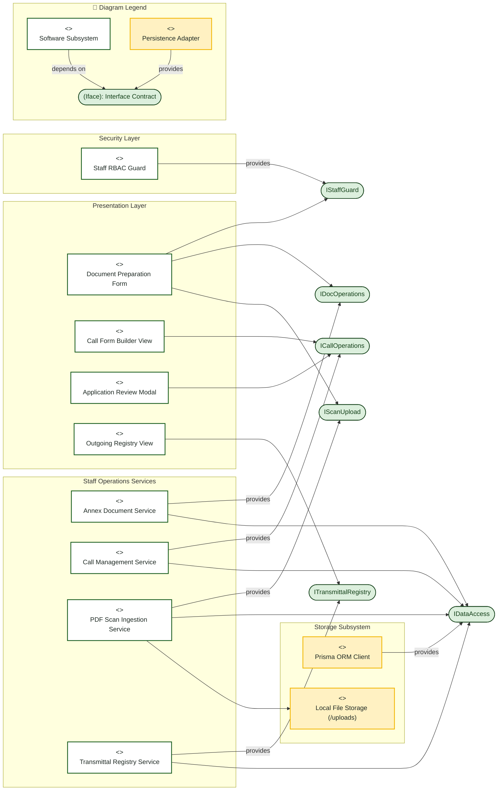
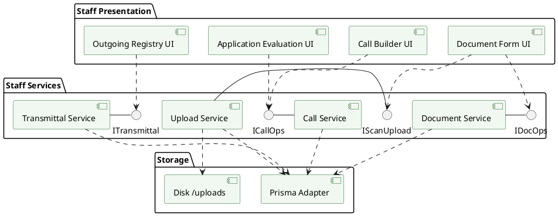

# Staff Coordinator — Component Diagram

> **Role:** `STAFF`  
> **Diagram Type:** Component Diagram  
> **Standard:** UML 2.5 Component Specification

---

## 1. Purpose

The Component Diagram shows the software components, provided interfaces, and required dependencies within the Staff operational subsystem.

---

## 2. Mermaid Component Diagram

---

## 3. Diagram Legend & Symbol Guide

| Visual Symbol | Syntax / Style | Technical Role | MinSU Architecture Mapping |
|---|---|---|---|
| `<<component>>` Box | `fill:#FFFFFF, stroke:#1B5E20` | Architectural subsystem or service module | Views, Controllers, Auth Services, Document Engines |
| `([Interface Circle])` | `fill:#DCEFDD, stroke:#123F17` | Provided / Required Interface Contract | `IAuthSession`, `IRBACGuard`, `IDocumentWorkflow`, `IDataAccess` |
| 🟨 Data Component | `fill:#FFF1C2, stroke:#F2B705` | Persistence & Storage adapter component | Prisma ORM Client, Local Storage Volume, Google Drive Client |
| `-->` Solid Arrow | Dependency / Consumer | Module calls or requires the interface | View components requiring workflow and auth interfaces |
| `-- provides -->` | Realization / Provider | Module implements or provides the interface | Service layer realizing database or workflow contracts |
| Boundary Subgraph | `subgraph LAYER` | Architectural tier / layer grouping | Presentation, Security, Domain Logic, and Persistence Layers |

---

## 4. PlantUML Component Diagram

---

## 5. Component Rules

- The `PDF Scan Ingestion Service` handles streaming multipart binary uploads directly to disk.
- The `Annex Document Service` ensures form payloads conform to the Zod schema for that Annex number.
