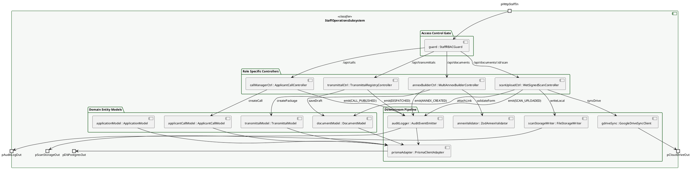

# Composite Structure Diagram: Staff Coordinator Domain

> **Role:** `STAFF_COORDINATOR`  
> **Diagram Type:** Composite Structure Diagram  
> **Classifier:** `StaffOperationsSubsystem`

---

## 1. Purpose

This Composite Structure Diagram depicts the internal architecture of the `StaffOperationsSubsystem`. It shows how incoming staff operations route through the coordinator access gate to specific controllers, how controllers connect to operational models, and where data moves downstream to schema validators, binary scan writers, cloud sync adapters, and database persistence.

---

## 2. Mermaid Composite Structure Diagram

```mermaid
flowchart TB
    %% Styling Classes
    classDef classifierStyle fill:#F6F8F6,stroke:#1B5E20,stroke-width:2.5px,color:#1F2A24
    classDef portStyle fill:#FFF1C2,stroke:#F2B705,stroke-width:2px,color:#1F2A24
    classDef guardStyle fill:#F1F8F1,stroke:#1B5E20,stroke-width:1.5px,color:#123F17
    classDef ctrlStyle fill:#EFF6FF,stroke:#2563EB,stroke-width:1.5px,color:#1E3A8A
    classDef modelStyle fill:#FAF5FF,stroke:#9333EA,stroke-width:1.5px,color:#581C87
    classDef svcStyle fill:#FEFCE8,stroke:#CA8A04,stroke-width:1.5px,color:#713F12
    classDef adapterStyle fill:#DCEFDD,stroke:#164D1C,stroke-width:2px,color:#123F17

    subgraph SUBSYSTEM["«classifier» StaffOperationsSubsystem"]
        direction TB

        %% Boundary Ingress Port
        pHttpStaffIn["Port: pHttpStaffIn<br/>(Staff Coordinator Actions / API Routes)"]:::portStyle

        %% Layer 1: Security & RBAC Gate
        subgraph LAYER_SECURITY ["Access Control Gate"]
            guard["guard : StaffRBACGuard<br/>• verifySessionToken()<br/>• enforceRole('STAFF_COORDINATOR')"]:::guardStyle
        end

        %% Layer 2: Role Specific Controllers
        subgraph LAYER_CONTROLLERS ["Role Specific Controllers"]
            annexBuilderCtrl["annexBuilderCtrl : MultiAnnexBuilderController<br/>• draftAnnex()<br/>• editAnnexFields()<br/>• submitToExecutiveQueue()"]:::ctrlStyle

            callManagerCtrl["callManagerCtrl : ApplicantCallController<br/>• createCall()<br/>• setSlotQuota()<br/>• closeIntakeWindow()"]:::ctrlStyle

            scanUploadCtrl["scanUploadCtrl : WetSignedScanController<br/>• uploadSignedScan()<br/>• validateScanMime()<br/>• attachGoogleDriveLink()"]:::ctrlStyle

            transmittalCtrl["transmittalCtrl : TransmittalRegistryController<br/>• createTransmittal()<br/>• bindCourierTracking()<br/>• dispatchToAgency()"]:::ctrlStyle
        end

        %% Layer 3: Domain Entity Models
        subgraph LAYER_MODELS ["Domain Entity Models"]
            documentModel["documentModel : DocumentModel<br/>- id: String<br/>- title: String<br/>- annexType: 'ANNEX_1' | 'ANNEX_2'..<br/>- status: DocumentStatus<br/>- metadata: Json"]:::modelStyle

            applicantCallModel["applicantCallModel : ApplicantCallModel<br/>- id: String<br/>- academicYear: String<br/>- semester: String<br/>- slotQuota: Int<br/>- isActive: Boolean"]:::modelStyle

            applicationModel["applicationModel : ApplicationModel<br/>- id: String<br/>- callId: String<br/>- studentNumber: String<br/>- status: ApplicationStatus"]:::modelStyle

            transmittalModel["transmittalModel : TransmittalModel<br/>- id: String<br/>- controlNumber: String<br/>- recipientAgency: String<br/>- status: TransmittalStatus<br/>- trackingNumber: String"]:::modelStyle
        end

        %% Layer 4: Downstream Services & Persistence ("Where it goes after")
        subgraph LAYER_DOWNSTREAM ["Downstream Pipeline & Cloud Sinks"]
            annexValidator["annexValidator : ZodAnnexValidator<br/>• validateAnnex1Schema()<br/>• validateAnnex2Schema()<br/>• validateAnnex10Schema()"]:::svcStyle

            scanStorageWriter["scanStorageWriter : FileStorageWriter<br/>• writeLocalBuffer()<br/>• checkMaxSizeBytes(15MB)"]:::svcStyle

            gdriveSync["gdriveSync : GoogleDriveSyncClient<br/>• uploadToSharedDrive()<br/>• generatePublicViewUrl()"]:::svcStyle

            auditLogger["auditLogger : AuditEventEmitter<br/>• emit('ANNEX_CREATED')<br/>• emit('CALL_PUBLISHED')<br/>• emit('TRANSMITTAL_DISPATCHED')"]:::svcStyle

            prismaAdapter["prismaAdapter : PrismaClientAdapter<br/>• document.upsert()<br/>• applicantCall.create()<br/>• transmittal.create()<br/>• auditLog.create()"]:::adapterStyle
        end

        %% Boundary Egress Ports
        pDbPostgresOut["Port: pDbPostgresOut<br/>(PostgreSQL Connection Pool)"]:::portStyle
        pAuditLogOut["Port: pAuditLogOut<br/>(Append-Only Audit Sink)"]:::portStyle
        pScanStorageOut["Port: pScanStorageOut<br/>(Local Storage Volume)"]:::portStyle
        pCloudDriveOut["Port: pCloudDriveOut<br/>(Google Drive Cloud Sync)"]:::portStyle

        %% Connectors: Ingress to Gate
        pHttpStaffIn -->|"HTTPS /api/*"| guard

        %% Gate to Controllers
        guard -->|"/api/documents"| annexBuilderCtrl
        guard -->|"/api/calls"| callManagerCtrl
        guard -->|"/api/documents/:id/scan"| scanUploadCtrl
        guard -->|"/api/transmittals"| transmittalCtrl

        %% Controllers to Validators & Models
        annexBuilderCtrl -->|"Validate structured fields"| annexValidator
        annexBuilderCtrl -->|"Hydrate / Save Draft"| documentModel

        callManagerCtrl -->|"Create Call Instance"| applicantCallModel

        scanUploadCtrl -->|"Stream PDF Buffer"| scanStorageWriter
        scanUploadCtrl -->|"Sync with Drive"| gdriveSync
        scanUploadCtrl -->|"Attach Scan Link"| documentModel

        transmittalCtrl -->|"Bind Approved Documents"| transmittalModel
        transmittalCtrl -->|"Update Document Status to SENT"| documentModel

        %% Models to Persistence Adapter
        documentModel -->|"Save Document Entity"| prismaAdapter
        applicantCallModel -->|"Save Call Entity"| prismaAdapter
        applicationModel -->|"Update Grantee List"| prismaAdapter
        transmittalModel -->|"Save Transmittal"| prismaAdapter

        %% Controllers to Downstream Emitters
        annexBuilderCtrl -->|"Emit creation event"| auditLogger
        callManagerCtrl -->|"Emit call publish event"| auditLogger
        scanUploadCtrl -->|"Emit scan uploaded event"| auditLogger
        transmittalCtrl -->|"Emit dispatch event"| auditLogger

        %% Downstream Services to Ports
        scanStorageWriter -->|"Write disk files"| pScanStorageOut
        gdriveSync -->|"Sync external drive"| pCloudDriveOut
        auditLogger -->|"Persist audit row"| prismaAdapter
        auditLogger -->|"Stream to audit SIEM"| pAuditLogOut
        prismaAdapter -->|"SQL Transactions / Port 5432"| pDbPostgresOut
    end

    %% ─── 📌 VISUAL LEGEND ───
    subgraph LEGEND ["📌 Diagram Legend"]
        direction TB
        L_Class["<<classifier>><br/>Encapsulating Unit"]:::classifierStyle
        L_Port["Port: pName<br/>(Interface Gate)"]:::portStyle
        L_Part["part : InternalComponent"]:::ctrlStyle
        L_Port -->|Delegation| L_Part
    end
```

---

## 3. PlantUML Alternative Syntax

---

## 4. Diagram Legend & Symbol Guide

| Visual Symbol | Syntax / Style | UML Structural Role | MinSU System Implementation |
|---|---|---|---|
| Outer Classifier | `subgraph SUBSYSTEM` (`#F6F8F6`) | Encapsulating software unit | `StaffOperationsSubsystem` governing Annex builder & registry |
| 🟨 Port Node | `pName` (`#FFF1C2` / `#F2B705`) | Interaction boundary / gate | Staff HTTP actions, database port, local storage, Google Drive sync |
| 🟩 Green Box | `guard : Class` (`#F1F8F1` / `#1B5E20`) | Security & RBAC Gatekeeper | Verifies session belongs to `STAFF_COORDINATOR` |
| 🟦 Blue Box | `ctrl : Class` (`#EFF6FF` / `#2563EB`) | Role-Specific Controller | Multi-Annex builder, Call manager, Scan uploader, Transmittal logger |
| 🟪 Purple Box | `model : Class` (`#FAF5FF` / `#9333EA`) | In-Memory Domain Model | Document, ApplicantCall, Application, Transmittal |
| 🟨 Yellow Box | `service : Class` (`#FEFCE8` / `#CA8A04`) | Downstream Utility / Service | Zod schema validator, disk storage writer, Google Drive client |
| 🟩 Dark Green Box | `adapter : Class` (`#DCEFDD` / `#164D1C`) | Persistence Client Adapter | Prisma client executing atomic SQL operations on PostgreSQL |
| `-->` Connector | Solid Arrow | Internal message flow | Directed method calls, file uploads, drive syncs, and event logs |

---

## 5. Parts, Ports, and Connectors Table

### 5.1 Boundary Ports
| Port Name | Direction | Interface / Protocol | Responsibility |
|---|---|---|---|
| `pHttpStaffIn` | Inbound | HTTPS (JSON / Multipart) | Ingests staff coordinator form inputs, application call configurations, and PDF uploads. |
| `pDbPostgresOut` | Outbound | TCP / SQL (Port 5432) | Connects to PostgreSQL database through Prisma connection pooling. |
| `pAuditLogOut` | Outbound | Event Stream | Transmits immutable audit log records to external compliance monitors. |
| `pScanStorageOut` | Outbound | Local Disk I/O | Stores wet-signed physical document scans inside the local `/uploads/scans` volume. |
| `pCloudDriveOut` | Outbound | Google Drive REST API | Uploads document scans to MinSU's official Google Drive for inter-agency archival. |

### 5.2 Subsystem Controllers
| Controller Part | Concrete File | Key Responsibilities |
|---|---|---|
| `annexBuilderCtrl : MultiAnnexBuilderController` | `src/app/api/documents/route.ts` | Handles drafting, editing, and submitting operational Annexes 1–5 and 10 to the executive review queue. |
| `callManagerCtrl : ApplicantCallController` | `src/app/api/calls/route.ts` | Configures scholarship intake rounds, sets applicant quotas, manages opening and cutoff dates. |
| `scanUploadCtrl : WetSignedScanController` | `src/app/api/documents/[id]/route.ts` | Validates file size (max 15MB) and MIME type (PDF), attaches signed scans, logs Google Drive links. |
| `transmittalCtrl : TransmittalRegistryController` | `src/app/api/transmittals/route.ts` | Generates official transmittal control numbers (`TRN-YYYY-XXXX`), packages approved annexes, records courier details. |

### 5.3 Domain Entity Models
| Model Part | Prisma Entity | Core Attributes Captured |
|---|---|---|
| `documentModel : DocumentModel` | `Document` | `id`, `title`, `annexType`, `status`, `createdById`, `metadata`, `updatedAt`. |
| `applicantCallModel : ApplicantCallModel` | `ApplicantCall` | `id`, `title`, `academicYear`, `semester`, `slotQuota`, `openDate`, `closeDate`, `isActive`. |
| `applicationModel : ApplicationModel` | `Application` | `id`, `callId`, `studentNumber`, `fullName`, `course`, `yearLevel`, `status`. |
| `transmittalModel : TransmittalModel` | `Transmittal` | `id`, `controlNumber`, `recipientAgency`, `status`, `trackingNumber`, `courierName`. |

### 5.4 Downstream Pipeline ("Where It Goes After")
| Downstream Part | Technology / Module | Action Taken After Controller / Model Mutation |
|---|---|---|
| `annexValidator : ZodAnnexValidator` | `src/lib/validation.ts` | Enforces structural data integrity for specific operational Annex schemas before database writes. |
| `scanStorageWriter : FileStorageWriter` | `src/lib/storage.ts` | Persists binary PDF streams to host filesystem with randomized secure filenames. |
| `gdriveSync : GoogleDriveSyncClient` | `src/lib/gdrive.ts` | Uploads signed scans to MinSU cloud storage and stores the resulting external hyperlink. |
| `auditLogger : AuditEventEmitter` | `src/lib/audit.ts` | Records immutable audit log entries (`ANNEX_CREATED`, `CALL_PUBLISHED`, `TRANSMITTAL_DISPATCHED`). |
| `prismaAdapter : PrismaClientAdapter` | `src/lib/prisma.ts` | Executes multi-model relational mutations inside atomic Prisma transactions. |

---

## 6. STE Rules Applied

- The diagram focuses on one classifier: the `StaffOperationsSubsystem`.
- External interactions enter and exit through clearly named ports.
- Sentences contain 25 words or fewer.
- Instructions start with imperative verbs.
