# Composite Structure Diagram: Staff Coordinator Domain

> **Role:** `STAFF_COORDINATOR`  
> **Diagram Type:** Composite Structure Diagram  
> **Classifier:** `StaffOperationsSubsystem`

---

## 1. Purpose

This Composite Structure Diagram depicts the internal architecture of the `StaffOperationsSubsystem`. It shows how incoming staff operations route through the coordinator access gate to controllers for document drafting, 3-way tripartite verification, registration validation, and certificate designing, connecting downstream to export sinks and persistence.

---

## 2. Mermaid Composite Structure Diagram

```mermaid
flowchart TB
    %% Styling Classes
    classDef classifierStyle fill:#F6F8F6,stroke:#1B5E20,stroke-width:2.5px,color:#1F2A24
    classDef portStyle fill:#FFF1C2,stroke:#F2B705,stroke-width:2px,color:#1F2A24
    classDef guardStyle fill:#F1F8F1,stroke:#1B5E20,stroke-width:1.5px,color:#123F17
    classDef ctrlStyle fill:#EFF6FF,stroke:#2563EB,stroke-width:1.5px,color:#1E3A8A
    classDef modelStyle fill:#FAF5FF,stroke:#9333EA,stroke-width:1.5px,color:#581C87
    classDef svcStyle fill:#FEFCE8,stroke:#CA8A04,stroke-width:1.5px,color:#713F12
    classDef adapterStyle fill:#DCEFDD,stroke:#164D1C,stroke-width:2px,color:#123F17

    subgraph SUBSYSTEM["«classifier» StaffOperationsSubsystem"]
        direction TB

        %% Boundary Ingress Port
        pHttpStaffIn["Port: pHttpStaffIn<br/>(Staff Coordinator Actions / API Routes)"]:::portStyle

        %% Layer 1: Security & RBAC Gate
        subgraph LAYER_SECURITY ["Access Control Gate"]
            guard["guard : StaffRBACGuard<br/>• verifySessionToken()<br/>• enforceRole('STAFF_COORDINATOR')"]:::guardStyle
        end

        %% Layer 2: Role Specific Controllers
        subgraph LAYER_CONTROLLERS ["Role Specific Controllers"]
            annexBuilderCtrl["annexBuilderCtrl : MultiAnnexBuilderController<br/>• draftAnnex()<br/>• editAnnexFields()<br/>• submitToExecutiveQueue()"]:::ctrlStyle

            verifyCtrl["verifyCtrl : TripartiteVerificationController<br/>• ingestDatasets()<br/>• executeCrossMatch()<br/>• resolveDiscrepancies()"]:::ctrlStyle

            regQueueCtrl["regQueueCtrl : StudentValidationController<br/>• reviewRegistration()<br/>• acceptApplicant()<br/>• lockStudentIdentity()"]:::ctrlStyle

            certDesignerCtrl["certDesignerCtrl : CertificateDesignerController<br/>• customizeSignatories()<br/>• setPaperDimensions()<br/>• exportWordLetters()"]:::ctrlStyle

            transmittalCtrl["transmittalCtrl : TransmittalRegistryController<br/>• createTransmittal()<br/>• bindCourierTracking()<br/>• dispatchToAgency()"]:::ctrlStyle
        end

        %% Layer 3: Domain Entity Models
        subgraph LAYER_MODELS ["Domain Entity Models"]
            documentModel["documentModel : DocumentModel<br/>- id, title, annexType, status, metadata"]:::modelStyle
            verifyRunModel["verifyRunModel : VerificationRunModel<br/>- id, runDate, matchedCount, discrepancyCount"]:::modelStyle
            applicationModel["applicationModel : ApplicationModel<br/>- id, studentNumber, status, identityLocked"]:::modelStyle
            certTemplateModel["certTemplateModel : CertificateTemplateModel<br/>- id, paperSize, signatories, orientation"]:::modelStyle
            transmittalModel["transmittalModel : TransmittalModel<br/>- id, recipient, trackingNumber, driveLink"]:::modelStyle
        end

        %% Layer 4: Downstream Services & Sinks
        subgraph LAYER_DOWNSTREAM ["Downstream Pipeline & Cloud Sinks"]
            fuzzyMatcher["fuzzyMatcher : JaroWinklerCrossMatcher<br/>• matchChedToRegistrar()<br/>• normalizeStudentIds()"]:::svcStyle

            excelExporter["excelExporter : ExcelJSExporter<br/>• buildMultiTabWorkbooks()<br/>• computeAdminFees()"]:::svcStyle

            wordExporter["wordExporter : DocxGenerator<br/>• renderAnnex10Awards()"]:::svcStyle

            auditLogger["auditLogger : AuditEventEmitter<br/>• emit('VERIFICATION_EXECUTED')<br/>• emit('REGISTRATION_ACCEPTED')<br/>• emit('TRANSMITTAL_DISPATCHED')"]:::svcStyle

            prismaAdapter["prismaAdapter : PrismaClientAdapter<br/>• documents, verificationRuns, templates, auditLogs"]:::adapterStyle
        end

        %% Boundary Egress Ports
        pDbPostgresOut["Port: pDbPostgresOut<br/>(PostgreSQL Connection Pool)"]:::portStyle
        pAuditLogOut["Port: pAuditLogOut<br/>(Append-Only Audit Sink)"]:::portStyle
        pExportsOut["Port: pExportsOut<br/>(Excel / Word Document Streams)"]:::portStyle
        pCloudDriveOut["Port: pCloudDriveOut<br/>(Google Drive Cloud Sync)"]:::portStyle

        %% Connectors
        pHttpStaffIn --> guard
        guard --> annexBuilderCtrl
        guard --> verifyCtrl
        guard --> regQueueCtrl
        guard --> certDesignerCtrl
        guard --> transmittalCtrl

        verifyCtrl --> fuzzyMatcher
        verifyCtrl --> verifyRunModel
        verifyRunModel --> documentModel

        regQueueCtrl --> applicationModel
        certDesignerCtrl --> certTemplateModel
        certDesignerCtrl --> wordExporter

        annexBuilderCtrl --> documentModel
        annexBuilderCtrl --> excelExporter
        transmittalCtrl --> transmittalModel

        documentModel --> prismaAdapter
        verifyRunModel --> prismaAdapter
        applicationModel --> prismaAdapter
        certTemplateModel --> prismaAdapter
        transmittalModel --> prismaAdapter

        excelExporter --> pExportsOut
        wordExporter --> pExportsOut
        transmittalCtrl --> pCloudDriveOut
        auditLogger --> prismaAdapter
        auditLogger --> pAuditLogOut
        prismaAdapter --> pDbPostgresOut
    end

    %% ─── 📌 VISUAL LEGEND ───
    subgraph LEGEND ["📌 Diagram Legend"]
        direction TB
        L_Class["<<classifier>><br/>Encapsulating Unit"]:::classifierStyle
        L_Port["Port: pName<br/>(Interface Gate)"]:::portStyle
        L_Part["part : InternalComponent"]:::ctrlStyle
        L_Port -->|Delegation| L_Part
    end
```

---

## 3. Diagram Legend & Symbol Guide

| Symbol | UML Concept | Technical Function | MinSU Operational Meaning |
|---|---|---|---|
| `«classifier»` | Subsystem Classifier | Encapsulates internal structural parts | `StaffOperationsSubsystem` |
| `Port` | Port Boundary | Ingress/egress interaction gate | HTTP Ingress, PostgreSQL DB Out, Document Stream Out |
| `part` | Internal Component Part | Role controller or internal service | `MultiAnnexBuilderController`, `TripartiteVerificationController` |
| `-->` | Connector | Structural delegation or data flow | Delegates verified data to persistence adapter |
