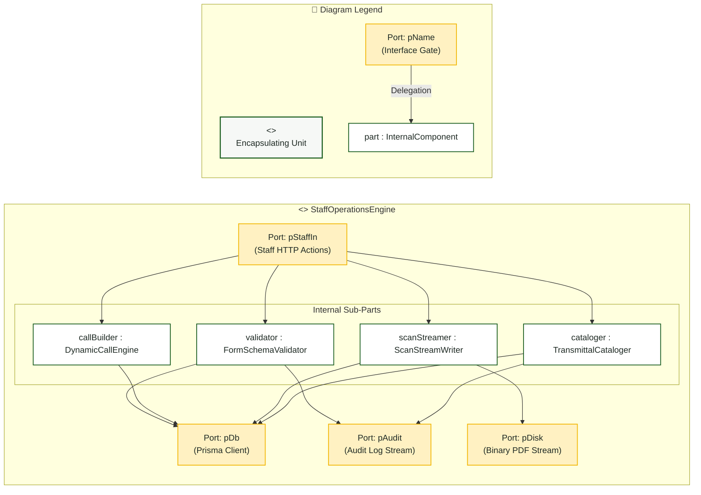

# Staff Coordinator — Composite Structure Diagram

> **Role:** `STAFF`  
> **Diagram Type:** Composite Structure Diagram  
> **Classifier:** `StaffOperationsEngine`

---

## 1. Purpose

The Composite Structure Diagram shows the internal parts, ports, and connectors of the `StaffOperationsEngine` that handles document preparation, scan storage, and transmittal logging.

---

## 2. Mermaid Composite Structure Diagram

---

## 3. Diagram Legend & Symbol Guide

| Visual Symbol | Syntax / Style | UML Structural Role | MinSU System Implementation |
|---|---|---|---|
| Outer Classifier | `subgraph UNIT` (`#F6F8F6`) | Encapsulating software unit | Domain engine or controller containing internal operational logic |
| 🟨 Port Node | `pName` (`#FFF1C2` / `#F2B705`) | Interaction boundary / gate | Inbound HTTP ports, state change events, database ports |
| ⬜ Internal Part | `part : Class` (`#FFFFFF` / `#1B5E20`) | Component instance owned by classifier | Schema validators, state machines, PDF compilers, audit loggers |
| `-->` Connector | Solid Arrow | Internal connector or port delegation | Linking external ports to internal validators and persistent adapters |

---

## 4. Parts and Ports Table

| Element | Type | Role |
|---|---|---|
| `pStaffIn` | Port | Ingests form submissions, call schemas, and scan uploads. |
| `validator` | Part (`FormSchemaValidator`) | Validates Annex inputs against Zod models. |
| `callBuilder` | Part (`DynamicCallEngine`) | Compiles dynamic form JSON for Annex 2 applicant calls. |
| `scanStreamer` | Part (`ScanStreamWriter`) | Verifies PDF MIME headers and writes binary files to disk. |
| `cataloger` | Part (`TransmittalCataloger`) | Records courier manifests and external GDrive URLs. |
| `pDisk` | Port | Writes signed PDF binaries to `/uploads/scans`. |
| `pDb` | Port | Persists database mutations. |
| `pAudit` | Port | Dispatches action events to the audit log. |
