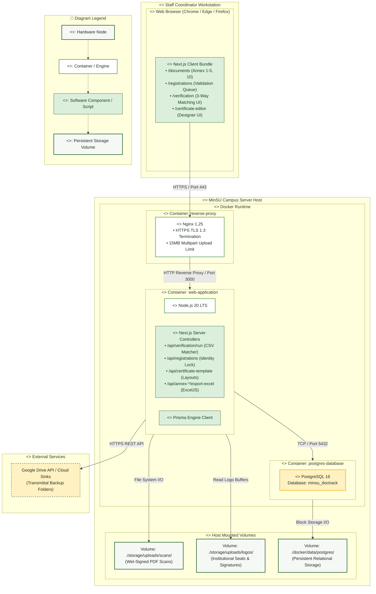

# Staff Coordinator — Deployment Diagram

> **Role:** `STAFF`  
> **Diagram Type:** Deployment Diagram  
> **Standard:** UML 2.5 Deployment Specification

---

## 1. Purpose

The Deployment Diagram shows the hardware nodes, execution containers, file storage volumes, and external cloud integrations that host Staff Coordinator services.

---

## 2. Mermaid Deployment Diagram

---

## 3. Diagram Legend & Symbol Guide

| Visual Symbol | Syntax / Style | UML Deployment Concept | MinSU Implementation |
|---|---|---|---|
| `<<device>>` | Double Bracket Node | Hardware computational machine | Coordinator workstation, campus physical server host |
| `<<executionEnvironment>>` | Runtime Sub-node | Container or execution platform | Docker engine, Node.js 20, PostgreSQL 16 engine |
| `<<artifact>>` | Shaded Pill / Box | Deployed software artifact | Next.js SPA bundle, API route handlers, Prisma engine |
| `<<storage>>` | File Volume Box | Persistent file system partition | Scanned PDFs volume, logo upload repository, database blocks |

---

## 4. Deployment Specifications

- **Client Workstation**: Renders the administrative SPA bundles with client-side CSV validation and fast fuzzy match previews.
- **Reverse Proxy**: Enforces a 15 MB file upload limit and routes requests securely to Node.js on port 3000.
- **Application Container**: Runs the in-memory 3-way cross-matching engine, ExcelJS streaming buffers, and dynamic Word generators.
- **PostgreSQL Container**: Stores normalized grantee records, audit events, and verification runs with persistent host disk volume mounting.
