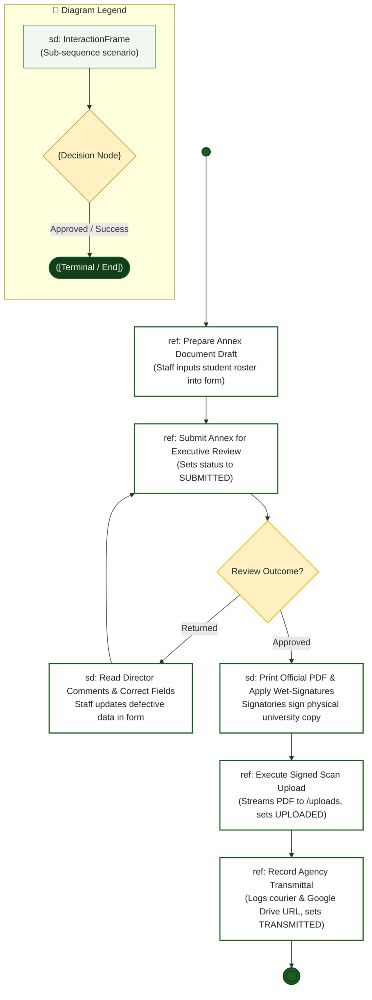

# Staff Coordinator — Interaction Overview Diagram

> **Role:** `STAFF`  
> **Diagram Type:** Interaction Overview Diagram  
> **Workflow:** Annex Preparation, Revision Loops, Scan Ingestion & Transmittal

---

## 1. Purpose

The Interaction Overview Diagram coordinates high-level staff activities with detailed sequence reference frames across the document lifecycle.

---

## 2. Mermaid Interaction Overview Diagram

---

## 3. Diagram Legend & Symbol Guide

| Symbol / Element | Syntax / Type | Technical Meaning | MinSU Interaction Context |
|---|---|---|---|
| `sd: FrameName` | `["sd: ..."]` | Sequence interaction scenario frame | Encapsulates an entire sequence scenario (e.g., `Authenticate`, `ReviewQueue`) |
| `{Decision}` | `{"Decision"}` | Activity decision branch point | Critical decision gate (e.g., approval vs. return, variance check) |
| `([Pill Node])` | `([Start / End])` | Lifecycle start or terminal archive node | Initiating semester operations or locking final records in archive |
| `-->` Solid Arrow | Control Flow Connector | Sequential hand-off between frames | Passing control from one interaction frame to the next |
| `-->|Label|` | Guarded Branch | Conditional scenario path | "Yes: Approved", "No: Discrepancy", "Return with Remarks" |
| 🟢 Green Box | `#F1F8F1` / `#1B5E20` | Successful Workflow Phase | Forward operational processing and executive approval |
| 🟡 Gold Diamond | `#FFF1C2` / `#B88A00` | Institutional Checkpoint | Evaluation queue and zero-variance fiscal math check |

---

## 4. Interaction Frames Table

| Frame Name | Type | Reference Link | Purpose |
|---|---|---|---|
| `Prepare Annex Document Draft` | Sequence (`ref`) | `src/components/documents` | Ingests student and stipend records into dynamic schema. |
| `Submit Annex for Executive Review` | Sequence (`ref`) | `src/app/api/documents/[id]/submit` | Validates form and places document into Director review queue. |
| `Read Director Comments & Correct Fields` | Inline (`sd`) | Review Comments | Unlocks form and applies feedback corrections. |
| `Print Official PDF & Apply Wet-Signatures` | Inline (`sd`) | Manual Step | Hardcopy printing and physical university dry seal. |
| `Execute Signed Scan Upload` | Sequence (`ref`) | [`sequence-diagram.md`](file:///c:/Users/Paolo%20Amor%20P.%20Palma/Desktop/NICKO/docs/diagrams/staff/sequence-diagram.md) | Ingests binary PDF scan and marks status `UPLOADED`. |
| `Record Agency Transmittal` | Sequence (`ref`) | [`sequence-diagram.md`](file:///c:/Users/Paolo%20Amor%20P.%20Palma/Desktop/NICKO/docs/diagrams/staff/sequence-diagram.md) | Dispatches package to CHED and updates Outgoing Registry. |
