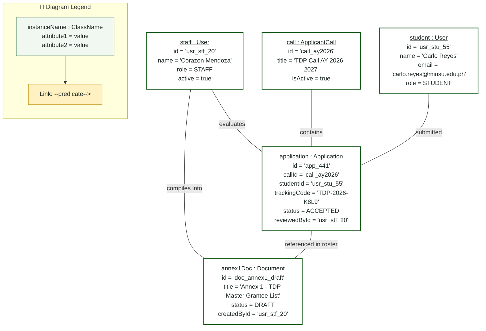
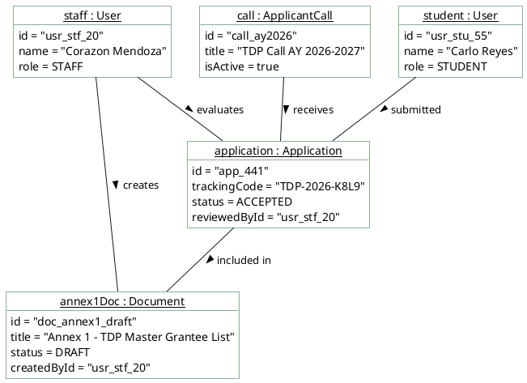

# Staff Coordinator — Object Diagram

> **Role:** `STAFF`  
> **Diagram Type:** Object Diagram  
> **Scenario:** Runtime Snapshot of Grantee Evaluation and Annex 1 Compilation  
> **Standard:** UML 2.5 Object Specification

---

## 1. Purpose

The Object Diagram shows a concrete runtime snapshot when the Staff Coordinator accepts a student application and compiles the record into an Annex 1 draft document.

---

## 2. Mermaid Object Diagram

---

## 3. Diagram Legend & Symbol Guide

| Visual Symbol | Syntax / Format | UML Role | MinSU Instance Context |
|---|---|---|---|
| Instance Node | `instanceName : ClassName` | Concrete runtime instance in memory/DB | Active users, specific scholarship calls, concrete annex documents |
| Attribute Values | `attr = 'value'` | Concrete state of instance properties | `status = 'APPROVED'`, `trackingCode = 'TDP-2026-0192'`, `slotQuota = 250` |
| `-->|predicate|` | Directed Association Link | Concrete relationship between runtime objects | User compiles document, director endorses record, transmittal dispatches |
| Subgraph Boundary | `subgraph GroupName` | Domain grouping boundary | Active Users, Intake Instances, Compiled Annexes, Transmittal Audits |
| 🟢 Green Container | `#F1F8F1` / `#1B5E20` | Operational Domain Entities | Authenticated staff/director records and approved scholarship documents |
| 🟡 Gold Node | `#FFF1C2` / `#B88A00` | Financial & Security Linkages | Ledger documents and audit log event tracking |

---

## 4. PlantUML Object Diagram

---

## 5. Instance Values & Observations

- The application's `status` changes to `ACCEPTED` after Staff review.
- The `annex1Doc` instance aggregates all accepted grantee applications into its tabular `formData`.
