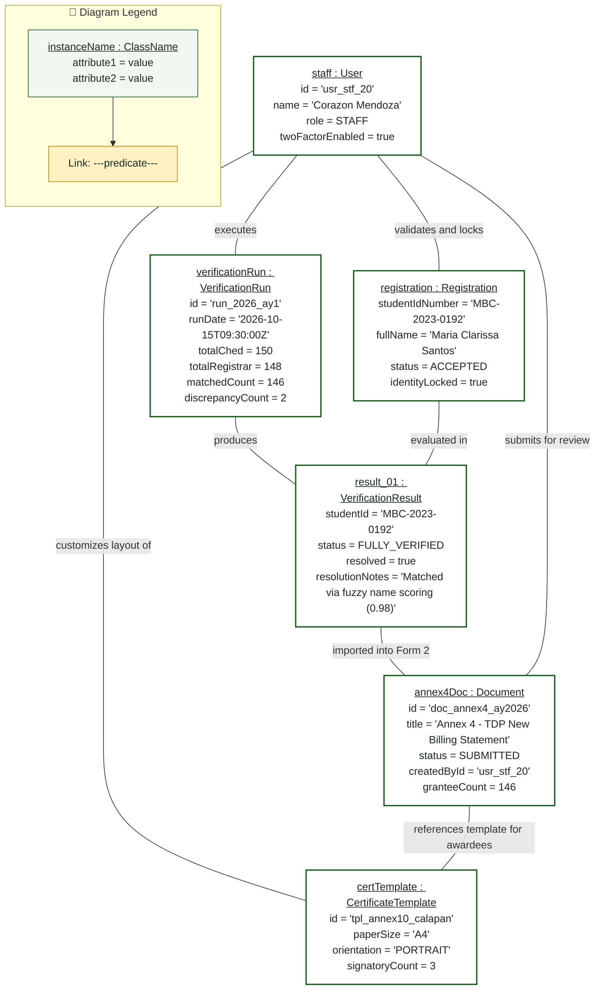

# Staff Coordinator — Object Diagram

> **Role:** `STAFF`  
> **Diagram Type:** Object Diagram  
> **Scenario:** Runtime Snapshot of Verification Run & Annex 4 Billing Compilation  
> **Standard:** UML 2.5 Object Specification

---

## 1. Purpose

The Object Diagram shows a concrete runtime snapshot when the Staff Coordinator executes a 3-way verification run, resolves student discrepancies, and compiles verified grantees into an Annex 4 billing document.

---

## 2. Mermaid Object Diagram

---

## 3. Diagram Legend & Symbol Guide

| Visual Symbol | Syntax / Format | UML Role | MinSU Instance Context |
|---|---|---|---|
| `<u>instance : Class</u>` | Underlined Identifier | Concrete runtime object in memory | Staff Coordinator, specific verification run, Annex 4 draft |
| `attr = 'value'` | Key-Value Assignment | Concrete state of instance attributes | `matchedCount = 146`, `identityLocked = true`, `status = ACCEPTED` |
| `---predicate---` | Undirected Semantic Link | Association relationship at runtime | Staff executes run, result imported into Annex 4 |
| 🟢 Green Tone | `#1B5E20` / `#F1F8F1` | Verified & Approved Entity | Validated student registration, verified cross-match result |

---

## 4. Runtime Object Attributes

- `staff`: Authenticated user with role `STAFF` and active two-factor authentication.
- `registration`: Student applicant whose Student ID and Name are permanently locked from modification.
- `verificationRun`: Batch execution that compared 150 CHED records with 148 Registrar records.
- `result_01`: Concrete discrepancy record resolved using Jaro-Winkler fuzzy matching.
- `annex4Doc`: Official billing document populated with the 146 verified grantees.
- `certTemplate`: Pre-configured award certificate template ready for batch Word (`.doc`) generation.
