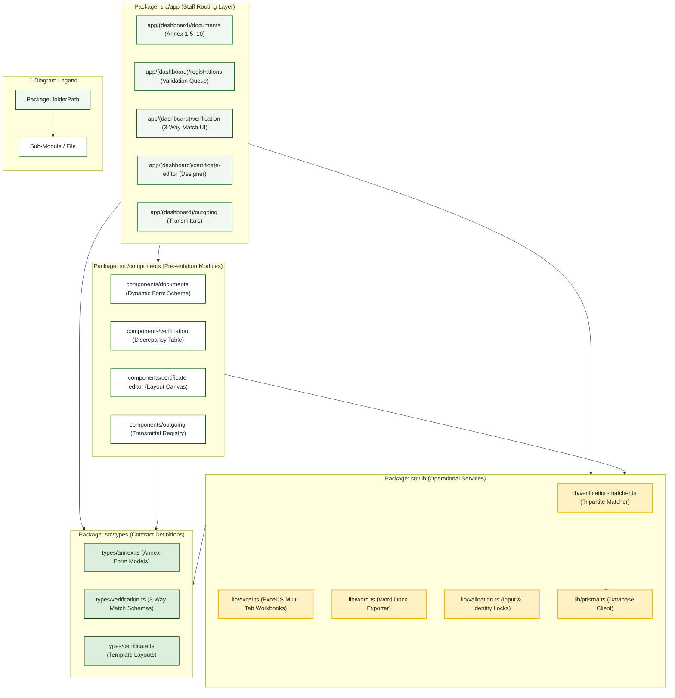

# Staff Coordinator — Package Diagram

> **Role:** `STAFF`  
> **Diagram Type:** Package Diagram  
> **Standard:** UML 2.5 Package Specification

---

## 1. Purpose

The Package Diagram shows the codebase packages, component folders, and utility libraries that build the Staff Coordinator operations subsystem.

---

## 2. Mermaid Package Diagram

---

## 3. Diagram Legend & Symbol Guide

| Visual Symbol | Syntax / Style | UML Package Concept | MinSU Implementation |
|---|---|---|---|
| `subgraph Pkg` | Folder Container | Architectural Namespace or Directory | `src/app`, `src/components`, `src/lib`, `src/types` |
| `[Module]` | Rectangle with border | Concrete file or sub-package | `verification-matcher.ts`, `excel.ts`, `validation.ts` |
| `-->` | Directed Dependency | Import or invocation relationship | Next.js routes import domain components and libraries |
| 🟢 Green Tone | `#F1F8F1` / `#1B5E20` | Operational Routing & UI Modules | User-facing dashboard paths and form generators |

---

## 4. Package Organization & Separation of Concerns

- **`src/app`**: Implements App Router endpoints for Annex management, validation queues, 3-way matching, and certificate designing.
- **`src/components`**: Houses modular UI components for table rendering, discrepancy filtering, and drag-and-drop certificate layout.
- **`src/lib`**: Encapsulates business logic including Jaro-Winkler string distance scoring, multi-tab `ExcelJS` generation, and immutable audit logging.
- **`src/types`**: Enforces strict TypeScript interfaces for Annex schemas, verification results, and template layouts.
